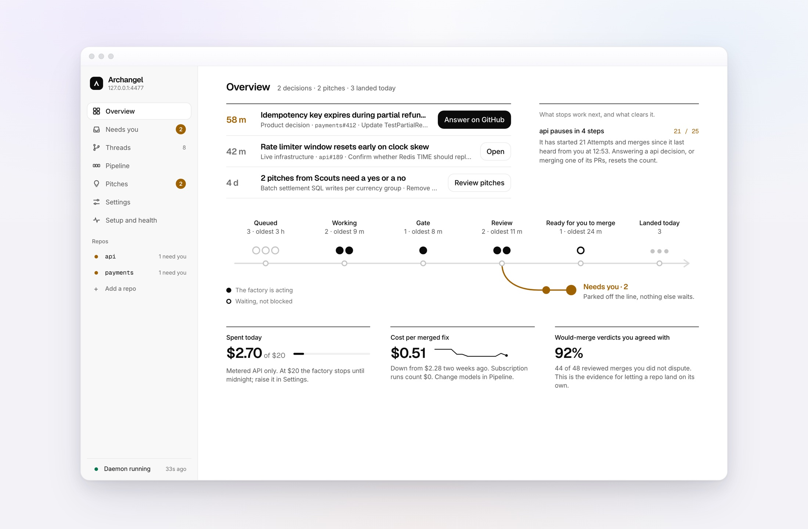

# Archangel

**Your own software factory that fixes bugs while you sleep.**

Archangel runs on your machine, watches your GitHub repositories, and turns real bugs into tested, reviewed pull requests—on the AI CLI subscriptions you already pay for (`codex`, `claude`, and `agy`, with automatic failover). Every bug fix has to prove itself with a new test that fails on `main` and passes on the fix, clear two independent reviewers from different vendors, and pass your CI before anything lands.

<picture>
  <source media="(prefers-color-scheme: dark)" srcset="assets/readme/hero-dark.jpg">
  <source media="(prefers-color-scheme: light)" srcset="assets/readme/hero-light.jpg">
  
</picture>

> On 2026-11-22, a bug Scout audited a Go repository, found a real parser bug, and filed it. Archangel implemented the fix, proved it through the mechanical Gate, passed two cross-vendor reviewers, and merged it into `main`—with nobody involved.

## How it works

<picture>
  <source media="(prefers-color-scheme: dark)" srcset="assets/readme/loop-dark.jpg">
  <source media="(prefers-color-scheme: light)" srcset="assets/readme/loop-light.jpg">
  
</picture>

1. **Scouts find bugs—or you file them.** Read-only Bug Scouts audit `main` on schedule (using `claude` or `codex` in read-only mode, scanning for secrets and deduplicating before filing) and open reproducible bug proposals. By default they wait for your `ready-for-agent` label; you can also opt a Scout into capped auto-promotion (`scouts.maxAutoPromotionsPerDay`, default `1`), which automatically revokes itself on any disagreement, revert, red `main`, or 3 unmerged Threads in a row. Owner-authored issues labelled `class:feature` run as features and always wait for your merge.
2. **Implement on the subscriptions you already pay for.** Archangel runs the provider chain for the Attempt's role (`chains.implement`, `chains.revise`, `chains.rebase`; `codex`, `claude`, `agy`, each with an optional `model`) in a throwaway clone with a scrubbed environment, so cheaper models can take the menial roles. If one provider hits a rate or quota limit, it records a cooldown and fails over to the next CLI while carrying the working tree forward. Metered API keys (`authMode: api`) work too.
3. **A mechanical Gate proves every fix.** Before review or merge, deterministic code checks diff bounds (at most 150 non-test lines, 300 total lines, 5 files, zero binaries), protected paths, pre-existing test and fixture immutability, and your repo's `.pre-commit-config.yaml` hooks from `main`. For bug fixes, it proves `main` is green, overlays your brand-new test file onto `main` to verify it compiles and fails (`>= 3` runs), then proves the suite passes on the fix (`>= 2` runs).
4. **Two independent reviewers must approve.** Every passing PR is reviewed in parallel by two models from different vendors than the one that wrote the code—one checking the contract and test, one trying to break the fix—with backup vendor failover if configured.
5. **It merges cleanly, then watches `main`.** Autonomous landing runs only when both the repo (`landing.bugfix: "autonomous"`) and your host (`shadowMode: false`) allow it. Every project defaults to `shadowMode: true`, posting a `WOULD MERGE` Recap so you can check agreement first. When it lands, it squash-merges the exact verified commit SHA and watches required checks on `main`: if `main` goes red, it trips the repo's circuit breaker and opens an exact-inverse revert PR for you to merge (or escalates to `Needs You` if `main` moved on).

## Built around a Trust Kernel

Autonomy only works when the safety rails live outside the models. Archangel's **Trust Kernel** is enforced in code that agents can never edit:

- **Protected paths agents can never change.** `.github/`, `.agents/`, `.pre-commit-config.yaml`, `.pre-commit-config.yml`, `.gitattributes`, `.gitmodules`, `CLAUDE.md`, `AGENTS.md`, and `LICENSE*`/`COPYING*` are always protected, plus each repo's `gate.protectedPaths` (lockfiles, build files, core modules). Enforced by the local Broker, the pinned CI Gate, and the Lander—backed by a least-privilege GitHub App (`contents:write`, `pull_requests:write`, `issues:write`, `checks:read`; never `workflows`, `administration`, or `checks:write`).
- **Strict version 1 workflow file, read only from `main`.** Each repo's `.agents/archangel.json` (`"version": 1`) is read strictly from the default branch, never from a PR. Kernel maxima (`150` non-test lines, `300` total lines, `5` files, `baseTestRuns >= 3`, `headTestRuns >= 2`) cannot be relaxed, and `requiredChecks` must include `Gate` plus at least one other CI check.
- **Fail-closed everywhere.** A missing or invalid `.agents/archangel.json` halts new work for that repo instead of falling back to defaults. Untrusted check apps (anything other than `github-actions`), edited issue bodies, tampered Scout proposals, and unparseable reviewer verdicts all stop progress.
- **Models can only veto.** The mechanical Gate and deterministic blocker checks decide merge eligibility. LLM reviewers can block a PR, never waive a failing check.
- **Owner identity by GitHub user ID.** Authorship, label actors (verified via GitHub's timeline API), reply commands, and PR review comments are checked against your numeric `ownerUserId`, never usernames.
- **Autonomy cap and host ceilings.** After `maxAutonomousStepsWithoutOwner` autonomous Attempt starts and merges (default `25`) without hearing from you, Archangel pauses new work until you reply or retry. Host ceilings in `archangel.yaml` (`maxAutoMergesPerDay`, `maxDailyUsd`, `maxConcurrentThreads`, Scout caps, `shadowMode`) cannot be raised by any repo.

Merge count is volume, not success. `archangel metrics` and the dashboard track what matters per merged fix: reverts, rework attempts, owner corrections, vendor agreement with you, and metered spend (`$0` on subscriptions).

<picture>
  <source media="(prefers-color-scheme: dark)" srcset="assets/readme/outcomes-dark.jpg">
  <source media="(prefers-color-scheme: light)" srcset="assets/readme/outcomes-light.jpg">
  
</picture>

## You stay in charge

You steer from GitHub (including mobile), your terminal, or a local dashboard—without babysitting agent chats.

- **Needs You with clear decisions.** Archangel escalates only into six decision classes (`credentials`, `spending`, `live infrastructure`, `irreversible`, `product decision`, `owner signoff`), each with a concrete recommendation on the PR Recap, `archangel status`, optional Telegram alerts, and the dashboard.
- **One-line commands on GitHub.** Answer a `Needs You` Thread by commenting on the issue or PR with a first line of:
  - `/archangel retry` — passes any text below it as guidance, grants a fresh Attempt budget, and resumes.
  - `/archangel close` — abandons the Thread and closes its PR.
  - `/archangel handoff` — records the request and reminds you to run `archangel handoff <issue>` locally for a Paseo takeover (`archangel resume <issue>` resumes advisory tracking afterward).
  - Add `factory:paused` or `factory:stop` at any time to halt a Thread immediately.
- **Inline PR review comments reach the next Attempt.** Leave inline diff comments or a review summary on the PR; when you retry (by comment, CLI, or removing `needs-you`), Archangel collects your review feedback and sends it to the implementer.
- **Daily digest.** Sent once per local day at or after `digestHour` (default `9`, over Telegram when configured) summarizing open `Needs You` items, yesterday's merges, reverts, metered spend, and open Scout proposals and pitches—and stays silent when there is nothing to report.
- **Local dashboard (`archangel ui`).** Reads straight from your local SQLite Ledger (`127.0.0.1:4477`), showing `Needs You`, active Threads, per-fix outcomes, Scout activity, and each repo's resolved pipeline with where every rule comes from (`kernel`, `host`, or `repo`). Its workflow editor previews semantic diffs, flags loosened limits, and **only ever opens an unmerged PR** with your `gh` CLI (labelled `policy:loosens` if any limit relaxes; disabled under `--allow-remote`; never writes `archangel.yaml`).

<picture>
  <source media="(prefers-color-scheme: dark)" srcset="assets/readme/pipeline-dark.jpg">
  <source media="(prefers-color-scheme: light)" srcset="assets/readme/pipeline-light.jpg">
  
</picture>

## Pitch Scouts, replay, and safe self-improvement

- **Pitch Scouts (`kind: "pitch"`).** Weekly or manual read-only Scouts file at most one evidence-backed improvement pitch (`removal`, `performance`, `architecture`, `ux`, or `feature`) labelled `agent-pitch`. Every pitch is mechanically checked against cited files and metrics, vetted by a cross-vendor critic, expired after 14 days unanswered, and paused after 4 consecutive unpromoted pitches. Pitch Scouts can never auto-promote: run `archangel pitch promote <repo> <issue>` to inspect every slice body in full and open owner-authored `class:feature` issues with your `gh` CLI (with optional `--slice <n>` or `--chain`).
- **Bundled skills.** Host-trusted playbooks in `skills/` (`general/`, `go/`, `typescript/`—a protected path) plug into any Scout via `folder/name` or `folder/*` (`archangel scout skills`). Unknown skills fail closed.
- **Replay and eval tooling.** Archangel pins commit history under `refs/archangel/eval/...`, records prompt/rubric/workflow hashes on every Attempt and review, counts repeated owner corrections in closed categories, and can feed sanitized metrics and failure clusters to opt-in Scouts (`includeMetrics: true`, like its own `self-audit`). Run `archangel replay` to re-run the mechanical Gate offline against captured Threads and six seeded corruptions of known-good fixes (add `--run-tests` to include test-dependent mutants); it exits `1` on any regression. Nothing edits its own prompts or rules automatically—prompt, skill, and Trust Kernel changes always require an owner-merged PR.

## Getting started

**Prerequisites:** Node.js 22+, `git >= 2.38`, authenticated GitHub CLI (`gh`), at least two logged-in subscription CLIs (`codex`, `claude`, `agy`)—or API keys for `authMode: api`—and a dedicated least-privilege GitHub App.

### 1. Install and configure credentials

```bash
git clone https://github.com/dgrah50/archangel.git
cd archangel
npm install && npm run build && npm link
```

Copy `.env.example` to `.env` (`chmod 600`)—or run `npx tsx scripts/create-github-app.ts` to create the least-privilege App via GitHub's manifest flow—and set `ARCHANGEL_GITHUB_APP_ID`, `ARCHANGEL_GITHUB_INSTALLATION_ID`, and `ARCHANGEL_GITHUB_PRIVATE_KEY_PATH` (plus `ARCHANGEL_GITHUB_BOT_USER_ID` if enabling Scouts, and optional Telegram vars).

### 2. Onboard a repository

```bash
archangel onboard owner/my-repo
```

Using your `gh` CLI, this creates the factory labels and opens one unmerged PR adding the pinned `.github/workflows/archangel-gate.yml`, a starter `.agents/archangel.json` (for Go and Node repos), and `.agents/scouts/bug-hunt.md`. Merge that PR, require `Gate` and your CI check in branch protection on `main`, and install your GitHub App on the repo.

### 3. Configure your host (`archangel.yaml`) and repo (`.agents/archangel.json`)

Copy `archangel.example.yaml` to `archangel.yaml` with your numeric GitHub user ID (`gh api user --jq .id`):

```yaml
ownerUserId: 123456
dailyTimezone: America/New_York
digestHour: 9
maxDailyUsd: 20
maxAutonomousStepsWithoutOwner: 25
authMode: subscription
chains:
  implement: [{ provider: codex }, { provider: agy }]
reviewerChain: [{ provider: agy }, { provider: claude }, { provider: codex }]
projects:
  - repo: owner/my-repo
    defaultBranch: main
    shadowMode: true
    maxConcurrentThreads: 2
    maxAutoMergesPerDay: 3
    scouts: { enabled: false, maxRunsPerDay: 2, maxOpenProposals: 3, maxAutoPromotionsPerDay: 1 }
```

Each repo keeps its verification rules and Scouts in `.agents/archangel.json` on `main`:

```json
{
  "version": 1,
  "gate": {
    "testFileGlobs": ["**/*_test.go"],
    "testBuildCmd": "go test -run=^$ ./...",
    "baseTestCmd": "go test -count=1 ./...",
    "testCmd": "go test -race -count=1 ./...",
    "protectedPaths": ["go.mod", "go.sum", "Makefile"]
  },
  "requiredChecks": ["Gate", "Test"],
  "landing": { "bugfix": "autonomous" },
  "scouts": [
    { "name": "bug-hunt", "schedule": "daily", "maxProposals": 2, "skills": ["general/bug-hunt", "go/*"], "promotion": "owner" }
  ]
}
```

### 4. Verify, start, and open the dashboard

```bash
archangel doctor --smoke   # verify config, App permissions, repo files, and CLI logins
archangel daemon install   # install & load the macOS launchd agent (or run `archangel start`)
archangel ui               # open the local dashboard at http://127.0.0.1:4477
```

## Commands

| Command | What it does |
|---|---|
| `archangel start [--once] [-c <path>]` | Run the reconciler daemon continuously, or run one tick and exit. |
| `archangel daemon <install\|uninstall\|status>` | Manage the macOS `launchd` user agent (no secrets in the plist). |
| `archangel onboard <repo> [--dry-run]` | Create labels and open one unmerged onboarding PR with your `gh` CLI. |
| `archangel doctor [--offline] [--smoke] [--json]` | Audit config, App permissions, repo files, Gate pin drift, and CLI logins. |
| `archangel ui [--port <n>] [--host <host>] [--allow-remote]` | Serve the local dashboard (`127.0.0.1:4477`) and PR-only workflow editor. |
| `archangel status [--repo <owner/name>] [--json]` | Show Threads by stage, `Needs You`, daily spend, merges, and shadow agreement. |
| `archangel metrics [--days <n>] [--repo <owner/name>] [--json]` | Show funnel stats, per-fix outcomes, corrections, vendor agreement, and cooldowns. |
| `archangel events [--repo <owner/name>] [--topic <prefix>] [--issue <n>]` | Inspect the append-only SQLite Ledger audit log (`--limit <n>`). |
| `archangel gate --base <ref> [--head <ref>] [--repo <dir>]` | Run the mechanical Gate locally (`--revert-of`, `--skip-pre-commit`, `--skip-tests`). |
| `archangel replay [--repo <owner/name>] [--since <days>] [--run-tests] [--json]` | Replay the Gate offline over captured Threads and seeded corruptions; exit `1` on regressions. |
| `archangel gate-bump <--repo <owner/name>\|--all> [--dry-run]` | Open one unmerged PR per drifted repo to re-pin `ARCHANGEL_GATE_SHA`. |
| `archangel workflow propose <repo> --file <path> [--dry-run]` | Validate a `.agents/archangel.json` draft and open one unmerged PR. |
| `archangel scout run [name] [--repo <owner/name>] [--dry-run]` | Run declared read-only Scouts against `main` (or list them with `--dry-run`). |
| `archangel scout skills` | List bundled Scout skills (`general/`, `go/`, `typescript/`). |
| `archangel pitch promote <repo> <issue> [--slice <n>] [--chain] [--yes]` | Turn a Pitch Scout proposal into owner-authored `class:feature` issues via your `gh` CLI. |
| `archangel retry <issue> [-m <text>] [--repo <owner/name>]` | Clear `needs-you`, pass optional guidance, grant a fresh Attempt budget, and resume. |
| `archangel abandon <issue> [--repo <owner/name>]` | Move a Thread to `done` (abandoned). |
| `archangel disagree <issue> [--repo <owner/name>]` | Mark owner disagreement on a merge (`factory:disagree` on GitHub and Ledger). |
| `archangel handoff <issue> [--repo <owner/name>] [--repo-dir <dir>]` | Pause autonomy and hand off the Thread's branch to Paseo. |
| `archangel resume <issue> [--repo <owner/name>]` | Resume advisory Gate and review tracking after Paseo handoff (owner merges manually). |
| `archangel reset-breaker [--repo <owner/name>]` | Reset a repo's red-main circuit breaker after `main` is green. |
| `archangel studio [--port <n>]` | Launch read-only Mastra Studio on `127.0.0.1` (default `4111`) against `mastra.db`. |

## Status

Archangel (`0.1.0`) is **pre-alpha**. It is built for a single owner running locally on their own machine: `archangel daemon install` targets macOS `launchd` (`archangel start` runs anywhere Node.js 22+ and `git >= 2.38` run), Attempts execute in throwaway clones with scrubbed environments rather than VM or container isolation, and CLI flags, config fields, and the Ledger schema may still change. Keep `shadowMode: true` on until you trust the verdicts, then turn on autonomous landing one repository at a time.
