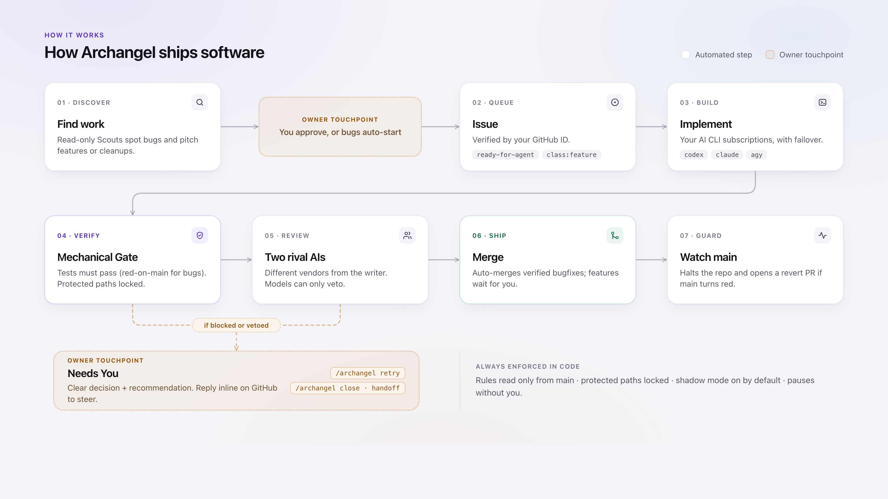
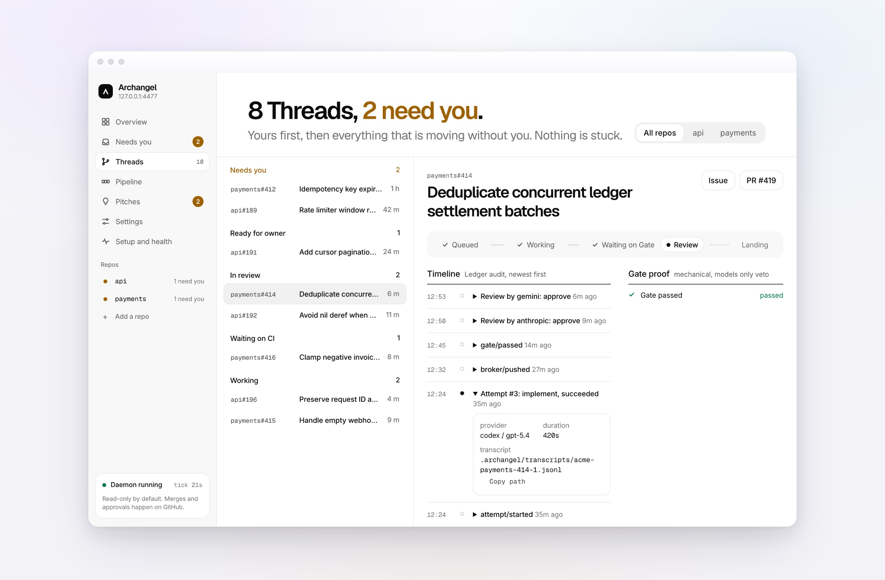
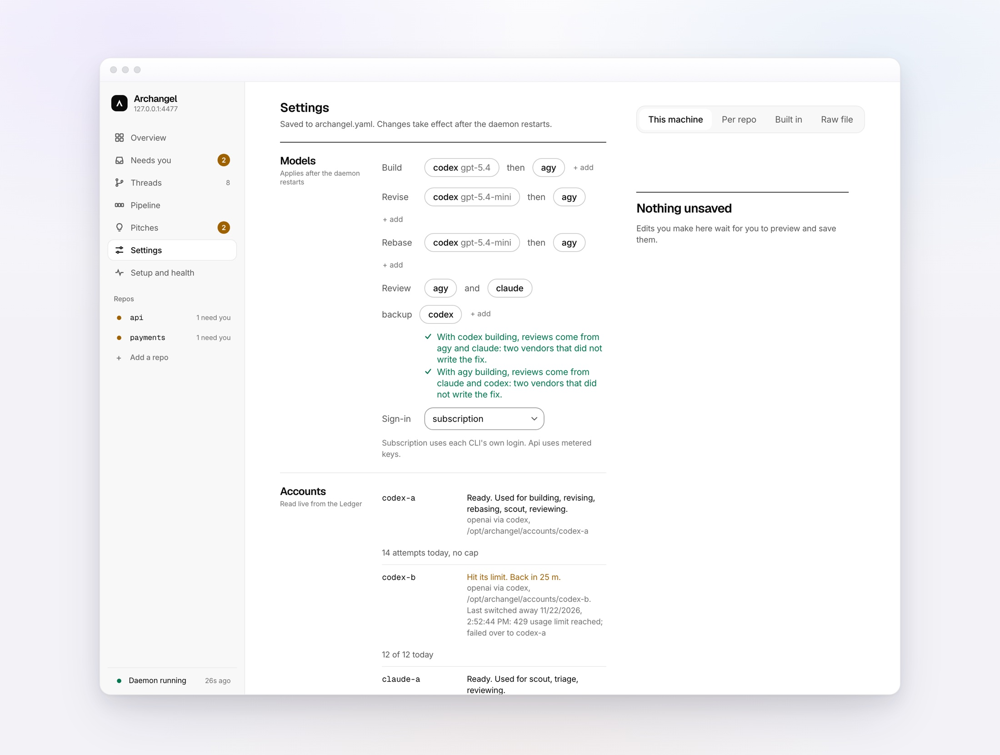
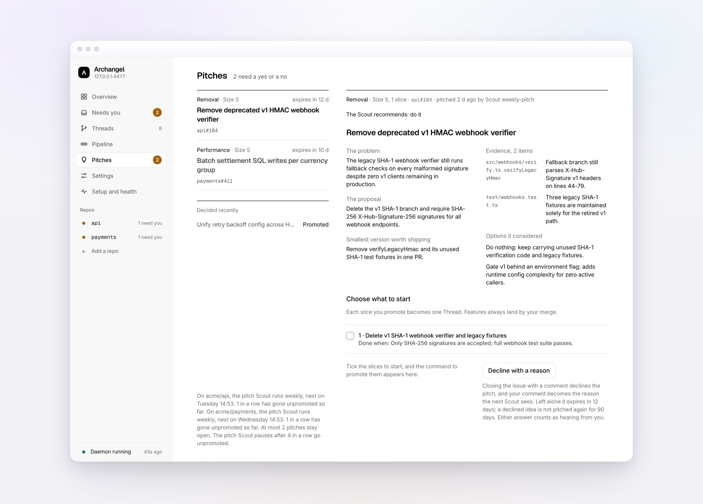

<h1 align="center">Archangel</h1>

<p align="center">
  <strong>Your own autonomous software factory. Ships bugs, features, and cleanups while you sleep.</strong>
</p>

<p align="center">
  Runs locally on the Claude, Codex, and Gemini subscriptions you already pay for.<br />
  Every pull request is verified by a mechanical Gate, reviewed by two rival AIs, and bounded by rules no agent can edit.
</p>

<p align="center">
  <a href="#get-started">Get started</a>
  &nbsp;·&nbsp;
  <a href="#how-it-works">How it works</a>
  &nbsp;·&nbsp;
  <a href="#capabilities">Capabilities</a>
  &nbsp;·&nbsp;
  <a href="#cli-reference">CLI reference</a>
  &nbsp;·&nbsp;
  <a href="#faq">FAQ</a>
</p>

<p align="center">
  <picture>
    <source media="(prefers-color-scheme: dark)" srcset="assets/readme/hero-dark.jpg">
    <source media="(prefers-color-scheme: light)" srcset="assets/readme/hero-light.jpg">
    
  </picture>
</p>

> **Shipping unattended today.** An agent audited a Go repository, found a real parser bug, wrote a failing-first test and fix, passed two independent AI reviewers, and merged into `main` without human intervention.

## Get started

**Requirements**

- Bun 1.4.5+, `git >= 2.38`, and GitHub CLI (`gh`)
- The AI CLIs your `archangel.yaml` chains use, each logged in. The example config uses `codex`, `agy`, and `claude`, and `doctor` fails if any configured one is missing. Trim the chains to the CLIs you have, keeping at least two vendors for cross-vendor review.

```bash
git clone https://github.com/dgrah50/archangel.git && cd archangel
bun install
bun src/cli/index.ts init          # creates archangel.yaml, .env and an empty Ledger; never overwrites
bun scripts/create-github-app.ts   # creates the App, then writes its ids into .env
bun src/cli/index.ts onboard owner/my-repo
bun src/cli/index.ts doctor --smoke && bun src/cli/index.ts ui
```

The App script creates a least-privilege GitHub App, saves its key, and waits for you to install it. It then writes `ARCHANGEL_GITHUB_APP_ID`, `ARCHANGEL_GITHUB_INSTALLATION_ID`, and `ARCHANGEL_GITHUB_BOT_USER_ID` into `.env`. If the App has several installations, it asks which to use. Add your own settings from `.env.example` to the same file.

`archangel.yaml` is read from the working directory (or `--config <path>`), and `.env` from beside it, so keep both in the same directory. Merge the onboarding pull request on GitHub, then start the daemon.

```bash
bun src/cli/index.ts start             # run in the foreground
bun src/cli/index.ts daemon install    # or install as macOS launchd background services (daemon and dashboard; needs `bun run build` first)
bun src/cli/index.ts daemon restart    # reload after editing archangel.yaml
```

> There is one launchd label per service (`com.archangel.daemon`, `com.archangel.ui`) per machine, so `daemon install` from a second checkout replaces the first.

After `daemon install` the dashboard is already running at `ui.host`:`ui.port` from `archangel.yaml` (default `http://127.0.0.1:4477`). `archangel ui` stays for looking at a Ledger without installing anything.

The **Setup and health** page inside `archangel ui` tracks the 6 setup groups directly from your machine and GitHub, displays onboarding PR check status, and links to a prefilled smoke issue.

## Why Archangel?

- **Runs on subscriptions you already pay for.** Drives native `claude`, `codex`, and `agy` CLIs across multiple logins per provider with automatic failover and `$0` API bills.
- **Proves every change mechanically.** Bugfixes must add a brand-new test that fails on `main` and passes on the branch. Features (`class:feature`) and chores (`class:chore`) need no new test file and must clear your full test suite. Existing tests stay immutable.
- **Enforces independent rival review.** If Codex writes the code, Claude and Gemini review it. Models can only approve or veto. No model can waive a failing Gate check.
- **Finds and pitches its own work.** Read-only Bug Scouts scan `main` on schedule, and optional fleet Scouts (`anti-slop-bugs`, `anti-slop-cleanup`, `fleet-pr-miner`) run across every configured repository. Weekly Pitch Scouts propose evidence-backed improvements and wait for you to promote individual slices.
- **Recovers before waking you.** Optional read-only machine triage retries a stuck Thread once (`escalations.factoryRetry: once`), records the triage steps in the PR Recap, and switches itself off per repo if retries stop paying off.
- **Keeps you in command from GitHub.** Leave normal inline PR review comments or reply `/archangel retry`, `/archangel close`, or `/archangel handoff`. Receive a quiet daily digest on Telegram.
- **Watches `main` after every merge.** If a landed fix turns CI red, Archangel trips the repo circuit breaker and opens an exact inverse revert PR automatically.

## How it works

Bugs can land end-to-end autonomously once you disable shadow mode. Features, chores, and promoted pitch slices are built, gated, and reviewed by the factory, then wait for your click to merge. Whenever a product call or conflict arises, Archangel parks that Thread in **Needs you** with a written recommendation while everything else keeps moving.

<p align="center">
  <picture>
    <source media="(prefers-color-scheme: dark)" srcset="assets/readme/loop-dark.jpg">
    <source media="(prefers-color-scheme: light)" srcset="assets/readme/loop-light.jpg">
    
  </picture>
</p>

| Layer | Responsibility |
| --- | --- |
| **Host config (`archangel.yaml`)** | Owner GitHub ID, multi-account logins, provider chains, daily spend caps, autonomy caps, and per-repo shadow mode. |
| **Repo policy (`.agents/archangel.json`)** | Diff bounds, test commands, required checks, protected paths, review rubric, factory retry toggle, and Scouts read strictly from `main`. |
| **Thread** | One issue's validated state machine (`queued`, `working`, `awaiting_plan`, `awaiting_gate`, `reviewing`, `landing`, `shadow_ready`, `needs_you`, `owner_driving`, `done`) stored in SQLite. |
| **Mechanical Gate** | Ephemeral CI check that validates diff bounds, protected paths, test immutability, pre-commit hooks, and test proofs. |
| **Rival Review** | Two independent vendors that never share a provider with the implementer. |

## Capabilities

### 1. Live Thread inspection and mechanical Gate proof

Every issue becomes a Thread with a phase stepper showing time spent in each stage, a newest-first Ledger audit timeline, full attempt provenance (provider, model, duration, transcript path), and a mechanical Gate proof checklist.

<p align="center">
  <picture>
    <source media="(prefers-color-scheme: dark)" srcset="assets/readme/threads-dark.jpg">
    <source media="(prefers-color-scheme: light)" srcset="assets/readme/threads-light.jpg">
    
  </picture>
</p>

- Filter active Threads by repository or jump directly to the GitHub issue and PR.
- Inspect every attempt, Broker push, Gate verdict, and rival review in one timeline.
- Merging any PR yourself resets that repository's autonomous step counter automatically.

### 2. Focused Needs You queue and bounded machine triage

When a Thread hits a conflict with an existing test, a reviewer veto, or a product decision, Archangel parks it off the main line so other Threads never stall. Each item arrives with a decision class, a per-Thread written recommendation, the latest Recap (including Gate status and diff size against repo bounds), recorded blockers, and an **Answered today** log.

<p align="center">
  <picture>
    <source media="(prefers-color-scheme: dark)" srcset="assets/readme/needs-you-dark.jpg">
    <source media="(prefers-color-scheme: light)" srcset="assets/readme/needs-you-light.jpg">
    
  </picture>
</p>

- Enable `escalations.factoryRetry: once` in `.agents/archangel.json` to let read-only machine triage attempt one guided recovery before paging you.
- Every triage run logs vendor, decision, cause, and steps into the PR Recap and tracks outcome labels with automatic per-repo shutoff if retries fail or revert.
- Set `features.planApproval: owner` to make each `class:feature` Thread post a machine-written plan first and wait. Apply the `plan:approved` label (only your application counts) to approve exactly that plan, or comment to have it re-planned (at most 2 plans, then it asks you).
- Answer directly on GitHub with inline review comments or `/archangel retry`, `/archangel close`, or `/archangel handoff`. The dashboard stays read-only and never posts as you.

### 3. Repo-owned pipeline and PR-only policy editing

Every repository's rules live in `.agents/archangel.json` on `main`. The **Pipeline** page explains what each stage enforces, shows which layer owns each rule (built-in kernel, this machine, or repo policy), and lets you draft edits that open a normal pull request.

<p align="center">
  <picture>
    <source media="(prefers-color-scheme: dark)" srcset="assets/readme/pipeline-dark.jpg">
    <source media="(prefers-color-scheme: light)" srcset="assets/readme/pipeline-light.jpg">
    
  </picture>
</p>

- Edit Gate bounds, protected paths, review rubrics, landing modes, and Scouts (including repo opt-outs for machine-wide fleet Scouts) with a bundled skills picker.
- Preview exact diffs before opening a PR. Any change that loosens a guardrail is flagged as `Looser` and labelled `policy:loosens`.
- Protected paths such as `.github/`, `.agents/`, lockfiles, and policy files stay off-limits to coding agents.

### 4. Subscription chains, multi-account failover, and host guardrails

Configure separate provider chains for `implement`, `revise`, `rebase`, `scout`, `triage`, and `reviewerChain` in **Settings** (form or raw YAML). Add, edit and remove logins per CLI in **Settings** (or under `accounts:` in `archangel.yaml`) without ever handing tokens to Archangel. The **Overview** shows each account's state and usage.

<p align="center">
  <picture>
    <source media="(prefers-color-scheme: dark)" srcset="assets/readme/settings-dark.jpg">
    <source media="(prefers-color-scheme: light)" srcset="assets/readme/settings-light.jpg">
    
  </picture>
</p>

- **Live vendor independence check.** Verifies as you edit that no reviewer shares a vendor with any writer chain.
- **Same-vendor-first failover.** Switches to a backup login of the same vendor before falling back across providers, bounded by a 4-switch cap, per-account daily limits, cooldown tracking, and full Ledger provenance.
- **Safe config writes.** Preview YAML diffs, require explicit confirmation when loosening host limits, write atomically with backups, and reload cleanly via `archangel daemon restart`.

### 5. Scouts, Pitches, dependency bumps, and offline self-improvement

Read-only Bug Scouts inspect `main` using bundled or repo-specific skills (`general/`, `go/`, `typescript/`). Machine-wide fleet Scouts (`anti-slop-bugs`, `anti-slop-cleanup`, `fleet-pr-miner`) run across every configured repository unless opted out in `.agents/archangel.json`, always with `promotion: owner`. Weekly Pitch Scouts propose scoped improvements backed by file citations and metrics.

<p align="center">
  <picture>
    <source media="(prefers-color-scheme: dark)" srcset="assets/readme/pitches-dark.jpg">
    <source media="(prefers-color-scheme: light)" srcset="assets/readme/pitches-light.jpg">
    
  </picture>
</p>

- **Slice-level pitch promotion.** Review open pitches, recently decided pitches, and the next scheduled pitch Scout run in the **Pitches** view. Tick the slices you want and run `archangel pitch promote <repo> <issue> --slice 1,2 --chain` to create owner-authored `class:feature` issues.
- **Cross-repo PR-miner (`fleet-pr-miner`).** Mines merged history, Ledger outcomes, Scout yields, and optional local notes (`fleetMinerSeeds`) to pitch new skills, Scouts, or Archangel improvements (marked provisional below 20 merged PRs).
- **Scrubbed dependency bumps (`archangel bump`).** Owner-run lane that bumps `bun`, `npm`, or `go` dependencies in a throwaway clone with install scripts disabled (`--ignore-scripts`), runs your `testCmd`, and opens an owner-authored unmerged PR. Never run by the daemon.
- **Correction-loop drafting.** When you repeatedly correct the factory in the same category, Archangel drafts a prompt, skill, or rubric update and scores it offline against your captured `dev` and held-out eval sets before opening a draft PR.
- **Model-tier benchmarking.** Capture revise and rebase inputs with pinned base heads, then run `archangel eval bench-tiers` to test cheaper or faster model chains against the mechanical Gate before editing `archangel.yaml`.

### 6. Local 7-page dashboard

Start `archangel ui` (loopback `127.0.0.1:4477` by default) to monitor and configure the factory across seven focused pages.

| Page | What it shows |
| --- | --- |
| **Overview** | Fixes landed per day, Threads at each station, daily spend, cost per merged fix, owner agreement rate, usage for every account, autonomy-cap warnings, and every Thread grouped by what it is waiting for. |
| **Needs you** | Oldest-first escalation queue with per-Thread recommendation, latest Recap (including Gate and Diff rows), blockers, Answered today log, and copyable `/archangel retry` commands. |
| **Threads** | Two-pane Thread browser grouped by urgency with per-phase durations on the phase stepper, Ledger audit timeline, and mechanical Gate proof. |
| **Pipeline** | Per-repo stage rules (Intake, Build, Gate, Review, Landing, Scouts), fleet Scout status, skills picker, and PR-only draft panel. |
| **Pitches** | Read-only Scout pitch viewer with evidence, options considered, slice checkboxes, copyable promote commands, recently decided pitches, and next pitch Scout schedule. |
| **Settings** | Machine settings (`Models`, `Accounts`, `Limits`, `Repos`, `Alerts`), Per-repo, Built-in kernel invariants, and Raw YAML tabs. |
| **Setup and health** | Setup wizard with 6 groups with derived progress, onboarding PR checks, 24h daemon faults, and saved eval, replay, and tier-benchmark reports. |

### 7. Mechanically verified codebase invariants

Archangel enforces its own reliability rules in CI so critical state transitions and error boundaries do not drift silently.

- **Exhaustive formal model checker (`bun run verify:formal`).** Explores reachable states of the Thread, Command, Pitch, and Daemon Lock state machines via BFS to verify safety invariants and liveness bounds.
- **Structural AST lint (`bun run lint`).** Blocks silent catch handlers and recurring failure modes across the TypeScript source tree.

## Running agents in the macOS sandbox

`compute.provider: sandbox` keeps every agent run on this machine and confines it with a macOS Seatbelt profile (`sandbox-exec`). The agent CLI, the repo's setup script and every command the agent starts (tests, builds) run under one profile that denies by default.

| The run can | The run cannot |
|---|---|
| Read and write its workspace, its temp dir and caches | Read anything else under your home: SSH keys, other checkouts, `.env` files |
| Read and run the system toolchain, the directories on your `PATH`, and the CLI's own install | Write outside the workspace, temp dir and its own login |
| Read and write the one login it runs on | Reach another CLI's login |
| Use the network | |

The last row is the difference from Sail. A sandboxed run can reach the network (the CLI must reach its model, and Seatbelt cannot filter by hostname) and it holds a real login, where a Sail box holds only a placeholder. Use Sail when that matters.

Each CLI's own sandbox is turned off inside the profile, because macOS cannot nest sandboxes. That is also why codex can commit and rebase here: its own sandbox mounts `.git` read-only.

**Logins.** A sandboxed run can write wherever its CLI can, so codex and agy must run on a login of their own, never the one you use yourself: give each an account with a `home` that holds only that login. The config is refused otherwise. claude keeps its login in the keychain and needs no home.

```yaml
compute:
  provider: sandbox
  sandbox:
    read: [~/.bun]            # optional: toolchains under your home that are not a PATH directory
    write: [~/go/pkg/mod]     # optional: caches a build must write

accounts:
  - { id: claude, provider: claude }
  - { id: codex, provider: codex, home: ~/.archangel/accounts/codex }   # CODEX_HOME=<home> codex login, with cli_auth_credentials_store = "file"
  - { id: agy, provider: agy, home: ~/.archangel/accounts/agy }         # HOME=<home> agy
```

`archangel doctor` checks that the sandbox can start. Reviews and Scouts are read-only and still run outside it.

## Running providers on Sail

A provider runs on a Sail box only when it has a remote credential in `compute.sail`; otherwise it runs on this machine with its own login. This is decided per chain entry and never changes mid-Attempt. Nothing from your account homes or environment ever enters a box: it holds placeholders, and the real key is swapped in on the wire for the one allow-listed model host. Run `sail auth login` once, then pick a route per provider. `archangel doctor` checks that each named Sail secret exists.

| Provider | Route | Config under `compute.sail` | Owner steps |
| --- | --- | --- | --- |
| claude | subscription token | `remoteClaudeAttempts: true`, `claudeTokenSecret` | `sail secret set CLAUDE_CODE_OAUTH_TOKEN` (hidden prompt) |
| codex | OpenAI API key | `codexApiKeySecret: OPENAI_API_KEY_SAIL` | create an OpenAI Platform API key, `sail secret set OPENAI_API_KEY_SAIL` |
| codex | dedicated ChatGPT login (broker) | `codexBrokerHome: ~/.archangel/accounts/codex-sail` | see below; exclusive with `codexApiKeySecret` |
| agy | Gemini API key | `geminiApiKeySecret: GEMINI_API_KEY_SAIL` | create a Google AI Studio API key (put a billing limit on the project), `sail secret set GEMINI_API_KEY_SAIL` |

| agy | dedicated Google login (broker) | `agyBrokerHome: ~/.archangel/accounts/agy-sail` | see "agy Google login broker" below; exclusive with `geminiApiKeySecret` |

The Gemini API key is the route Google recommends for third-party use. The broker route uses a Google subscription login, which Google's Antigravity terms bar for third-party tools; you accept that risk, so use a dedicated Google account that you can afford to lose.

Set the secrets at the hidden prompt, never as an argument, and add the config:

```yaml
compute:
  provider: sail
  sail:
    app: archangel
    codexApiKeySecret: OPENAI_API_KEY_SAIL
    geminiApiKeySecret: GEMINI_API_KEY_SAIL
```

For the broker route, create a second, separately paid ChatGPT account (never your main one), then:

```sh
mkdir -p ~/.archangel/accounts/codex-sail
printf 'cli_auth_credentials_store = "file"\n' > ~/.archangel/accounts/codex-sail/config.toml
CODEX_HOME=~/.archangel/accounts/codex-sail codex login
```

Never log that account in anywhere else: its refresh token rotates and only the broker may use it. Then set `codexBrokerHome` and verify as below. You decide whether the OpenAI terms allow this use; the API-key route is the documented default for automation.

### Verify the codex ChatGPT broker (once, after creating the dedicated account)

A box ships git, Node, Bun and the agent CLIs only. A project that needs another toolchain (Go, Rust, Python) lists it under its `projects` entry as `sailImage`: `setup` is shell commands run as root, in order, after the base image, and `egressHosts` are the extra hosts the box may reach (the default allowlist is the model hosts and registry.npmjs.org). Nothing is detected. Changing either builds a new image and saved egress policy; the same two fields under `compute.sail.image` set a host-wide default that `sailImage` replaces.

```yaml
projects:
  - repo: owner/name
    sailImage:
      setup:
        - 'curl -fsSL https://go.dev/dl/go1.26.0.linux-amd64.tar.gz | tar -C /usr/local -xz && ln -s /usr/local/go/bin/go /usr/local/go/bin/gofmt /usr/local/bin/'
      egressHosts: [proxy.golang.org, sum.golang.org, storage.googleapis.com]
```

`compute.sail.codexBrokerHome` points at a CODEX_HOME holding a dedicated ChatGPT login (never your main account) stored as a file (`cli_auth_credentials_store = "file"`). The daemon's token broker is the only thing that refreshes it: it lets codex do the refresh (`codex app-server`, `account/read` with `refreshToken`), writes only the access token to the Sail secret `ARCHANGEL_CODEX_ACCESS`, and refreshes at about half the token's life. A box holds a placeholder and cannot reach `auth.openai.com`, so it can never refresh. If a refresh fails the broker writes a sentinel into the secret and Attempts refuse to start; a 401 mid-Attempt fails the Attempt and is never retried by copying tokens.

Two things are not proven until you run them on the real account:

1. Start the daemon, then run `archangel doctor`. The `Sail token broker (codex)` check prints the measured access-token lifetime. Refreshes are scheduled from it, so a short lifetime is fine, but note it.
2. Let one codex Attempt run on a throwaway issue. It must reach `chatgpt.com` and answer; a `401` in its transcript means the placeholder was not swapped on the wire for the login file (not env). Then remove `codexBrokerHome` from the config and use `codexApiKeySecret` instead.

### agy Google login broker

Create a dedicated Google account (never your main one). Give it a HOME of its own so agy finds no keychain and keeps its login in a file, and log in there:

```sh
mkdir -p ~/.archangel/accounts/agy-sail
HOME=~/.archangel/accounts/agy-sail agy    # choose "Google OAuth", open the URL, paste the code
ls ~/.archangel/accounts/agy-sail/.gemini/antigravity-cli/antigravity-oauth-token
```

If macOS shows a "Keychain Not Found" dialog, dismiss it; agy then falls back to the file. Then set `agyBrokerHome: ~/.archangel/accounts/agy-sail` and start the daemon. The broker forces agy to refresh that login (`agy models` with only that HOME), writes only the access token to the Sail secret `ARCHANGEL_AGY_ACCESS`, and repeats at about half its life. The box gets a synthetic login file holding a placeholder and no route to `oauth2.googleapis.com`, so it can never refresh. Run `archangel doctor` and read the `Sail token broker (agy)` check, then let one agy Attempt run on a throwaway issue; the Cloud Code hosts an Attempt needs beyond `daily-cloudcode-pa.googleapis.com` are not yet proven on a real account.

## Configuration examples

<details>
<summary><strong>Host config (<code>archangel.yaml</code>) and repo policy (<code>.agents/archangel.json</code>)</strong></summary>

Host config (`archangel.yaml`):

```yaml
ownerUserId: 123456 # gh api user --jq .id
accounts:
  - { id: codex-a, provider: codex, home: ~/.archangel/accounts/codex-a }
  - { id: codex-b, provider: codex, home: ~/.archangel/accounts/codex-b, maxAttemptsPerDay: 12 }
  - { id: claude-a, provider: claude, home: ~/.archangel/accounts/claude-a }
  - { id: agy-a, provider: agy, home: ~/.archangel/accounts/agy-a }
chains:
  implement: [{ provider: codex, model: gpt-5.4 }, { provider: agy }]
  revise: [{ provider: codex, model: gpt-5.4-mini }, { provider: agy }]
  rebase: [{ provider: codex, model: gpt-5.4-mini }, { provider: agy }]
  scout: [{ provider: claude }, { provider: codex }]
  triage: [{ provider: claude }]
reviewerChain: [{ provider: agy }, { provider: claude }, { provider: codex }]
fleetScouts: [anti-slop-bugs, anti-slop-cleanup] # optional: add fleet-pr-miner and fleetMinerSeeds
projects:
  - repo: owner/my-repo
    defaultBranch: main
    shadowMode: true
    maxConcurrentThreads: 2
    maxAutoMergesPerDay: 3
    scouts: { enabled: false, maxRunsPerDay: 2, maxOpenProposals: 3, maxAutoPromotionsPerDay: 1 }
```

Repo policy (`.agents/archangel.json` on `main`):

```json
{
  "version": 1,
  "gate": {
    "maxNonTestLines": 120,
    "maxTotalLines": 260,
    "maxFiles": 5,
    "baseTestRuns": 3,
    "headTestRuns": 3,
    "testFileGlobs": ["**/*_test.go"],
    "testBuildCmd": "go test -run=^$ ./...",
    "baseTestCmd": "go test -count=1 ./...",
    "testCmd": "go test -race -count=1 ./...",
    "protectedPaths": ["go.mod", "go.sum", "Makefile"]
  },
  "requiredChecks": ["Gate", "Test"],
  "landing": { "bugfix": "autonomous" },
  "escalations": { "factoryRetry": "once" },
  "scouts": [
    { "name": "bug-hunt", "schedule": "daily", "maxProposals": 2, "skills": ["general/bug-hunt", "go/*"], "promotion": "owner" },
    { "name": "weekly-pitch", "kind": "pitch", "schedule": "weekly", "maxProposals": 1, "skills": ["general/bug-hunt"], "includeMetrics": true, "promotion": "owner" }
  ]
}
```

</details>

## CLI reference

<details>
<summary><strong>All CLI commands and flags</strong></summary>

| Command | What it does |
| --- | --- |
| `archangel init` | Create `archangel.yaml`, `.env` (mode 0600) and an empty Ledger in the current directory. Never overwrites, safe to rerun. |
| `archangel start [--once] [-c <path>]` | Run the reconciler daemon continuously, or execute one tick and exit. |
| `archangel daemon <install\|restart\|uninstall\|status>` | Install, gracefully restart (waiting for Ledger lock release), uninstall, or inspect the macOS `launchd` agents for the daemon and the dashboard. |
| `archangel onboard <repo> [--dry-run]` | Create labels and open one onboarding PR with your `gh` CLI (never auto-merged). |
| `archangel bump <repo> [pkgs...] [--patch\|--minor] [--yes]` | Bump dependencies in a throwaway clone with install scripts disabled, run `testCmd`, and open an owner-authored PR (never merged or run by the daemon). |
| `archangel doctor [--offline] [--smoke] [--json]` | Verify host config, GitHub App permissions, repo files, Gate pin, and CLI logins. |
| `archangel ui [--port <n>] [--host <host>] [--allow-remote]` | Serve the local 7-page dashboard. Host and port default to `ui.host` / `ui.port` in `archangel.yaml` (else `http://127.0.0.1:4477`). Remote mode disables all write routes. |
| `archangel status [--repo <owner/name>] [--json]` | Print active Threads, `Needs you` queue, daily spend, merges, and shadow agreement. |
| `archangel metrics [--days <n>] [--repo <owner/name>] [--json]` | Print outcomes per merged fix, owner corrections, vendor agreement, and active cooldowns. |
| `archangel events [--repo <owner/name>] [--topic <prefix>] [--issue <n>] [--limit <n>]` | Inspect the append-only SQLite audit log. |
| `archangel scout run [name] [--repo <owner/name>] [--dry-run]` | Run read-only Scouts against `main`, or list declared Scouts with `--dry-run`. |
| `archangel scout fix <repo> <issue> [--yes]` | Owner-run fix for a Scout's bug proposal that touches protected paths: implements it locally, runs the repo's tests, shows the diff, then opens an owner-authored PR from `selfbuild/fix-<issue>`. You merge it; the daemon never does. |
| `archangel scout skills` | List bundled Scout skills (`general/`, `go/`, `typescript/`). |
| `archangel pitch promote <repo> <issue> [--slice <n>] [--chain] [--yes]` | Turn pitch slice(s) (single number or comma list like `1,2`) into owner-authored `class:feature` issues. |
| `archangel pitch promote <repo> <issue> --slice <n> --build [--yes]` | Owner-run self-build for a slice touching protected paths: implements it locally, shows the diff, then opens an owner-authored PR from `selfbuild/<issue>-<n>`. You merge it; the daemon never does. |
| `archangel workflow propose <repo> --file <path> [--prompts <dir>] [--base-sha <sha256>] [--dry-run]` | Validate a `.agents/archangel.json` draft and open one unmerged PR. |
| `archangel gate --base <ref> [--head <ref>] [--repo <dir>] [--skip-tests]` | Run the mechanical Gate locally against a repository ref. |
| `archangel gate-bump <--repo <owner/name>\|--all> [--dry-run]` | Open PRs to re-pin `ARCHANGEL_GATE_SHA`. Run it when a Gate fix matters; an older pinned Gate is safe. |
| `archangel replay [--repo <owner/name>] [--since <days>] [--run-tests] [--json]` | Replay the mechanical Gate offline against captured PRs and seeded corruptions. |
| `archangel eval status [--repo <owner/name>]` | Show captured eval vault counts against calibration milestones. |
| `archangel eval run --candidate <patch> [--heldout] [--max-cases <n>] [--json]` | Score a candidate prompt, skill, or rubric patch offline against captured review cases. |
| `archangel eval bench-tiers --role <role> --candidate-chain <chain> [--run-tests] [--max-cases <n>] [--json]` | Benchmark a candidate `implement`, `revise`, or `rebase` chain against the current chain using the mechanical Gate. |
| `archangel retry <issue> [--repo <owner/name>] [-m <text>]` | Clear `needs_you`, re-snapshot the issue body, and resume a Thread with optional guidance. |
| `archangel abandon <issue> [--repo <owner/name>]` | Move a Thread to `done(abandoned)`. |
| `archangel disagree <issue> [--repo <owner/name>]` | Record owner disagreement (`factory:disagree`) on a shadow or autonomous merge. |
| `archangel handoff <issue> [--repo <owner/name>] [--repo-dir <dir>]` | Pause factory autonomy and hand off a Thread branch to Paseo. |
| `archangel resume <issue> [--repo <owner/name>]` | Resume advisory Gate and review tracking after a Paseo handoff. |
| `archangel reset-breaker [--repo <owner/name>]` | Clear a repository's red-main circuit breaker once `main` is green. |

</details>

## FAQ

### Do I need paid API keys to run Archangel?

No. Archangel drives the native `claude`, `codex`, and `agy` CLIs that you log into yourself. If you have multiple accounts for a provider, list their separate home directories under `accounts:` in `archangel.yaml` and Archangel fails over cleanly on rate limits without reading or copying credentials.

### How does the mechanical Gate differ from AI review?

The Gate is deterministic code running in an ephemeral GitHub Actions job pinned to `ARCHANGEL_GATE_SHA`. It reads `.agents/archangel.json` and `.pre-commit-config.yaml` strictly from `main`, verifies diff line and file caps, blocks edits to protected paths and existing tests, and runs test proofs. Bugfixes must add a new test that fails on `main` and passes on the fix branch. Features and chores require no new test file and must pass your full test suite. Only after the mechanical Gate passes do two rival AIs review the diff, and reviewers can only veto.

### Will Archangel merge features or edit its own rules?

No. Features, chores, dependency bumps, and promoted pitches always wait for your merge on GitHub. Policy files, CI workflows, and lockfiles are universally or explicitly protected, so agents cannot edit them. Even edits made in the local dashboard's Pipeline editor only open an unmerged pull request using your `gh` CLI.

### What happens when a repository starts in shadow mode?

New repositories default to `shadowMode: true`. Archangel runs the full loop (build, Gate, rival review) and records whether it would have merged, while leaving the actual merge to you. Once the Overview dashboard shows high owner agreement on shadow verdicts, you can turn off shadow mode for autonomous bugfix landing.

### Does Archangel run on Linux or only macOS?

The reconciler daemon (`archangel start`), CLI commands, Gate, and local dashboard (`archangel ui`) run on both macOS and Linux with Bun. Only the Gate bundle (`bin/archangel-gate.mjs`) runs on Node 22, inside the target repo's GitHub Actions. The `archangel daemon install|restart|uninstall|status` helper manages macOS `launchd` specifically.

---

**Pre-alpha.** Built for a single owner running locally. Local clone isolation is advisory, while GitHub App scopes and the pinned CI Gate are hard boundaries.

**License.** MIT. See [LICENSE](./LICENSE).
