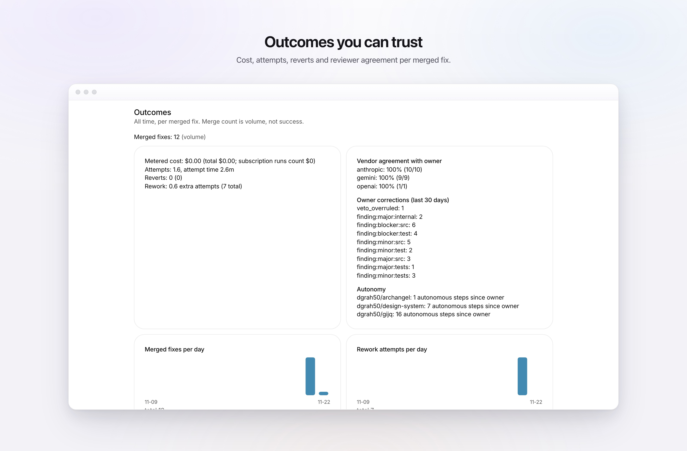

<h1 align="center">Archangel</h1>

<p align="center">
  <strong>Your own software factory. Ships bugs, features, and chores while you sleep.</strong>
</p>

<p align="center">
  Runs on your machine using the Claude, Codex, and Gemini subscriptions you already pay for.<br />
  Every pull request is proved by tests, reviewed by two rival AIs, and bounded by rules no agent can edit.
</p>

<p align="center">
  <picture>
    <source media="(prefers-color-scheme: dark)" srcset="assets/readme/hero-dark.jpg">
    <source media="(prefers-color-scheme: light)" srcset="assets/readme/hero-light.jpg">
    
  </picture>
</p>

> **Already shipping unattended:** An agent audited a Go repository, spotted a real parser bug, wrote a failing-first test and fix, cleared two independent AI reviewers, and merged into `main`—without a human touching it.

---

### What it does

- **Finds its own work.** Read-only agents (*Scouts*) scan your repos on schedule to catch real bugs and pitch features, speedups, and cleanups—or pick up any GitHub issue you label.
- **Runs on the subscriptions you already pay for.** Uses your native `claude`, `codex`, and `agy` CLIs with automatic failover when one hits a rate limit. `$0` API bills.
- **Proves every change mechanically.** Bug fixes must ship a brand-new test that fails on `main` and passes on the fix. Features must clear your full test suite. No edited tests, no shortcuts.
- **Reviewed by two rival AIs.** If Codex writes the code, Claude and Gemini review it. Models can only veto—never waive a failing check.
- **Steer from GitHub, even on mobile.** Leave normal inline PR review comments or reply `/archangel retry`, `/archangel close`, or `/archangel handoff`. Get a quiet daily digest on Telegram.
- **Watches `main` after landing.** If a merged fix ever turns CI red, Archangel halts the repo and opens an exact revert PR automatically.

---

## From idea to merged PR

Bugs can land end-to-end autonomously. Features and cleanup pitches are built and reviewed by the factory, then wait for your click to merge. Whenever something is ambiguous, Archangel pauses and asks you with a clear recommendation.

<picture>
  <source media="(prefers-color-scheme: dark)" srcset="assets/readme/loop-dark.jpg">
  <source media="(prefers-color-scheme: light)" srcset="assets/readme/loop-light.jpg">
  
</picture>

---

## Real guardrails, enforced in code

Autonomy only works when safety doesn't rely on asking an LLM to behave. Every repository's rules live in one file on `main`, and the dashboard shows exactly what's enforced—and lets you propose changes as a normal PR.

- **Protected paths stay locked.** CI workflows, lockfiles, and core policy files are physically off-limits to agents.
- **Verified by your GitHub ID.** Only you can approve features, steer retries, or change rules.
- **Safe by default.** New repos start in shadow mode (dry-run verdicts) and pause automatically if they haven't heard from you.

<picture>
  <source media="(prefers-color-scheme: dark)" srcset="assets/readme/pipeline-dark.jpg">
  <source media="(prefers-color-scheme: light)" srcset="assets/readme/pipeline-light.jpg">
  
</picture>

---

## Measure quality, not PR volume

Shipping fast means nothing if it creates rework. Track reverts, attempts per fix, and reviewer agreement in the local dashboard—and replay prompt or rubric changes offline against past pull requests before shipping them.

<picture>
  <source media="(prefers-color-scheme: dark)" srcset="assets/readme/outcomes-dark.jpg">
  <source media="(prefers-color-scheme: light)" srcset="assets/readme/outcomes-light.jpg">
  
</picture>

---

## Get running in minutes

**Requires:** Node.js 22+, `git >= 2.38`, GitHub CLI (`gh`), a least-privilege GitHub App (`npx tsx scripts/create-github-app.ts`), and 2+ logged-in AI CLIs (`codex`, `claude`, `agy`).

```bash
git clone https://github.com/dgrah50/archangel.git && cd archangel
npm install && npm run build && npm link
archangel onboard owner/my-repo
archangel doctor --smoke && archangel ui
```

Copy `.env.example` → `.env` and [archangel.example.yaml](./archangel.example.yaml) → `archangel.yaml`, merge the onboarding PR on your repo, then run `archangel start` (or `archangel daemon install` on macOS).

<details>
<summary><strong>Configuration examples (host & repo)</strong></summary>

Host config (`archangel.yaml`):

```yaml
ownerUserId: 123456 # gh api user --jq .id
authMode: subscription
chains:
  implement: [{ provider: codex }, { provider: agy }]
  revise: [{ provider: codex }, { provider: agy }]
  rebase: [{ provider: codex }, { provider: agy }]
  scout: [{ provider: claude }, { provider: codex }]
reviewerChain: [{ provider: agy }, { provider: claude }, { provider: codex }]
projects:
  - repo: owner/my-repo
    defaultBranch: main
    shadowMode: true
    maxConcurrentThreads: 2
    maxAutoMergesPerDay: 3
    scouts: { enabled: false, maxRunsPerDay: 2, maxOpenProposals: 3, maxAutoPromotionsPerDay: 1 }
```

Repo policy (`.agents/archangel.json` on `main`):

```json
{
  "version": 1,
  "gate": {
    "testFileGlobs": ["**/*_test.go"],
    "testBuildCmd": "go test -run=^$ ./...",
    "baseTestCmd": "go test -count=1 ./...",
    "testCmd": "go test -race -count=1 ./...",
    "protectedPaths": ["go.mod", "go.sum", "Makefile"]
  },
  "requiredChecks": ["Gate", "Test"],
  "landing": { "bugfix": "autonomous" },
  "scouts": [
    { "name": "bug-hunt", "schedule": "daily", "maxProposals": 2, "skills": ["general/bug-hunt", "go/*"], "promotion": "owner" }
  ]
}
```

</details>

<details>
<summary><strong>All CLI commands</strong></summary>

| Command | What it does |
|---|---|
| `archangel start [--once] [-c <path>]` | Run the reconciler daemon continuously, or run one tick and exit. |
| `archangel daemon <install\|uninstall\|status>` | Manage the macOS `launchd` background service. |
| `archangel onboard <repo> [--dry-run]` | Create labels and open one onboarding PR with your `gh` CLI. |
| `archangel doctor [--offline] [--smoke] [--json]` | Verify config, App permissions, repo files, Gate pin drift, and CLI logins. |
| `archangel ui [--port <n>] [--host <host>] [--allow-remote]` | Open the local dashboard (`http://127.0.0.1:4477`) and PR-only workflow editor. |
| `archangel status [--repo <owner/name>] [--json]` | Show active work, `Needs You`, daily spend, merges, and shadow agreement. |
| `archangel metrics [--days <n>] [--repo <owner/name>] [--json]` | Show outcomes per fix, corrections, vendor agreement, and cooldowns. |
| `archangel events [--repo <owner/name>] [--topic <prefix>] [--issue <n>]` | Inspect the append-only SQLite audit log. |
| `archangel scout run [name] [--repo <owner/name>] [--dry-run]` | Run read-only Scouts against `main` (or list them). |
| `archangel scout skills` | List bundled Scout skills (`general/`, `go/`, `typescript/`). |
| `archangel pitch promote <repo> <issue> [--slice <n>] [--chain] [--yes]` | Turn a Pitch Scout proposal into owner-authored `class:feature` issues. |
| `archangel workflow propose <repo> --file <path> [--dry-run]` | Validate a `.agents/archangel.json` draft and open one unmerged PR. |
| `archangel gate --base <ref> [--head <ref>] [--repo <dir>]` | Run the mechanical Gate locally. |
| `archangel gate-bump <--repo <owner/name>\|--all> [--dry-run]` | Open PRs to re-pin `ARCHANGEL_GATE_SHA` on drifted repos. |
| `archangel replay [--repo <owner/name>] [--since <days>] [--run-tests] [--json]` | Replay the Gate offline against captured PRs and seeded corruptions. |
| `archangel eval status\|run\|bench-tiers` | Score candidate prompt, rubric, or model-tier changes offline against captured cases. |
| `archangel retry\|abandon\|disagree <issue>` | Steer, cancel, or flag disagreement on a Thread from your terminal. |
| `archangel handoff\|resume <issue>` | Hand off a branch to Paseo for interactive work, then resume tracking. |
| `archangel reset-breaker [--repo <owner/name>]` | Reset a repo's red-main circuit breaker once `main` is green. |
| `archangel studio [--port <n>]` | Launch read-only Mastra Studio against `mastra.db`. |

</details>

---

## What's next

- **Fleet-wide anti-slop Scouts** — run shared code-hygiene and cleanup checks across every repo you own.
- **Self-improving work generation** — learn from your merged PRs across projects to pitch new skills, Scouts, and workflow upgrades.
- **First-class chores & package bumps** — automated maintenance and safe dependency updates.
- **Reactive triggers** — kick off work from any event: merged PRs, advisories, releases, or production error spikes.

---

**Pre-alpha** · Built for a single owner running locally (local clone isolation is advisory; GitHub App scopes and the CI Gate are hard boundaries).

**License:** MIT — see [LICENSE](./LICENSE).
