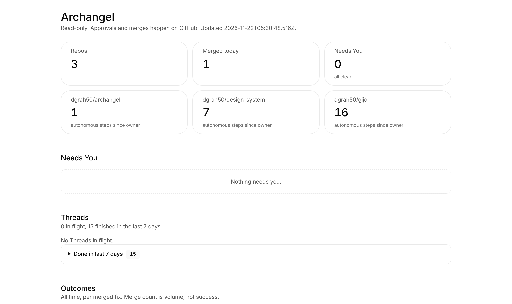
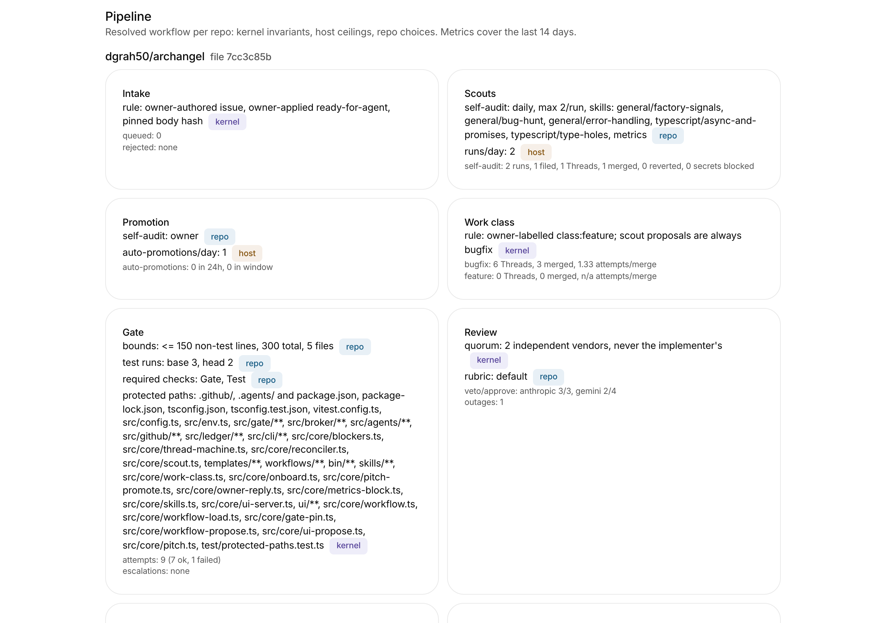

# Archangel

**Your own software factory that fixes bugs while you sleep.**

Archangel runs on your machine, watches your GitHub repositories, and turns issues you label `ready-for-agent`—or bugs its own Scouts uncover—into tested, reviewed pull requests using the AI CLI subscriptions you already pay for. Every bug fix has to prove itself with a new test that fails on `main` and passes on the fix, clear two independent reviewers from different vendors, and satisfy every required CI check before anything lands. You stay in charge from GitHub, your terminal, or a local dashboard, and nothing merges on its own until you turn autonomous landing on.

<picture>
  <source media="(prefers-color-scheme: dark)" srcset="assets/dashboard-dark.png">
  <source media="(prefers-color-scheme: light)" srcset="assets/dashboard-light.png">
  
</picture>

## What it does

- **Watches your GitHub repos.** A single local daemon polls your configured repositories and picks up issues you author and label `ready-for-agent`, along with verified proposals filed by its Scouts. Owner-authored issues carrying `class:feature` run as feature work and always wait for your merge.
- **Uses your existing CLI subscriptions.** Runs `codex`, `claude`, and `agy` in a configured fallback chain with automatic failover, rate-limit cooldowns, and git workspace continuity between providers (or metered API keys via `authMode: api`).
- **Proves each bug fix with a mechanical Gate.** Before anything can pass review or merge, the Gate checks diff bounds, protected paths, pre-existing test and fixture immutability, and your repo's `.pre-commit-config.yaml` hooks. For bug fixes, it verifies `main` is green, overlays the brand-new test onto `main` to prove it compiles and fails, then runs the suite on the fix to prove it passes.
- **Independent cross-vendor review.** Every passing PR is reviewed in parallel by two models from different vendors than the one that wrote the code, with automatic failover if a backup vendor is configured.
- **Merges cleanly, and catches regressions.** When every check and both reviews pass (and autonomous landing is enabled), Archangel squash-merges the exact verified commit SHA. It keeps watching `main` afterward: if required checks go red, it trips the repo's landing circuit breaker and opens an exact-inverse revert PR for you to merge (or escalates to `Needs You` if `main` has moved on).

## Why you can trust it

Autonomy only works when the safety rails sit outside the models. Archangel's **Trust Kernel** is enforced in deterministic code that agents cannot edit:

- **Protected paths agents can never touch.** `.github/`, `.agents/`, `.pre-commit-config.yaml`, `.pre-commit-config.yml`, `.gitattributes`, `.gitmodules`, `CLAUDE.md`, `AGENTS.md`, and `LICENSE*` are always protected, plus any repo-specific `gate.protectedPaths` (such as lockfiles or build files). Enforced by the local Broker, the pinned CI Gate, and the Lander—backed by a least-privilege GitHub App (`contents:write`, `pull_requests:write`, `issues:write`, `checks:read`; never `workflows`, `administration`, or `checks:write`).
- **Strict version 1 workflow file, read only from `main`.** Each repo's `.agents/archangel.json` (`"version": 1`) is read strictly from the default branch, never from a PR. Kernel maxima (`maxNonTestLines: 150`, `maxTotalLines: 300`, `maxFiles: 5`, `baseTestRuns >= 3`, `headTestRuns >= 2`) cannot be exceeded, and `requiredChecks` must name `Gate` plus at least one other CI check.
- **Fail-closed everywhere.** A missing or invalid `.agents/archangel.json` halts new work for that repo instead of falling back to defaults. Untrusted check apps (anything other than `github-actions`), edited issue bodies, tampered Scout proposals, and unparseable reviewer outputs all stop progress.
- **Models can only veto.** The mechanical Gate and deterministic blocker checks decide whether a PR is eligible to land. LLM reviewers can block a merge, never waive a failing check.
- **Owner identity by GitHub user ID.** Intake authorship, label actors (verified through GitHub's timeline API), reply commands, and PR review feedback are checked against your numeric `ownerUserId` in `archangel.yaml`, never usernames.
- **Autonomy step cap.** Once a repo hits `maxAutonomousStepsWithoutOwner` autonomous Attempt starts and merges (default `25`) without hearing from you, Archangel pauses new work and notifies you until you reply or retry.
- **Daily caps and shadow mode.** Host ceilings in `archangel.yaml`—`maxAutoMergesPerDay` (default `3`), `maxDailyUsd` (default `$20`, atomically reserved before metered calls), `maxConcurrentThreads` (default `2`), and Scout run caps—cannot be raised by any repo. Every project defaults to `shadowMode: true`, posting a `WOULD MERGE` Recap so you can measure agreement before letting it merge on its own.

## You stay in charge

- **Needs You with clear decisions.** Archangel only escalates into six decision classes (`credentials`, `spending`, `live infrastructure`, `irreversible`, `product decision`, `owner signoff`), each with a concrete recommendation on the PR Recap, `archangel status`, optional Telegram alerts, and the dashboard.
- **Reply right on GitHub.** Answer a `Needs You` Thread by commenting on the issue or PR with a first line of:
  - `/archangel retry` — passes any text below it as guidance, grants a fresh Attempt budget, and resumes.
  - `/archangel close` — abandons the Thread and closes its PR.
  - `/archangel handoff` — records the request and reminds you to run `archangel handoff <issue>` locally for a Paseo takeover (`archangel resume <issue>` resumes advisory tracking afterward).
  - Add `factory:paused` or `factory:stop` on GitHub at any time to halt a Thread immediately.
- **Inline PR review comments reach the next Attempt.** Leave inline diff comments or a review summary on the PR; when you retry (by comment, CLI, or removing `needs-you`), Archangel collects your review feedback and sends it to the implementer.
- **Daily digest.** Sent once per local day at or after `digestHour` (default `9`, over Telegram when configured) with open `Needs You` items, yesterday's merges, reverts, metered spend, and open Scout proposals—and stays silent when there is nothing to report.
- **Read-only local dashboard.** `archangel ui` serves a local view (`127.0.0.1:4477`) straight from your SQLite Ledger showing `Needs You`, pipeline stages, per-fix outcomes, and Scout activity. Its built-in workflow editor previews semantic diffs, flags loosened limits, and **only ever opens an unmerged PR** using your `gh` CLI (labelled `policy:loosens` if any limit relaxes; disabled under `--allow-remote`; never touches `archangel.yaml`).

<picture>
  <source media="(prefers-color-scheme: dark)" srcset="assets/pipeline-dark.png">
  <source media="(prefers-color-scheme: light)" srcset="assets/pipeline-light.png">
  
</picture>

## Scouts and skills

Scouts are read-only auditors declared in a repo's `.agents/archangel.json` with a plain-Markdown prompt body at `.agents/scouts/<name>.md`. They run on throwaway clones via `claude` or `codex` in read-only mode, scan findings for secrets, deduplicate by title, and run on schedule when a repo's queue is idle:

- **Bug Scouts** (`kind: "bug"`, the default—like the `bug-hunt` Scout created by `onboard`, or Archangel's own `self-audit` with `includeMetrics: true`) file reproducible bug proposals labelled `agent-proposed`.
- **Pitch Scouts** (`kind: "pitch"`) run weekly or manually and file at most one structured improvement proposal (`removal`, `performance`, `architecture`, `ux`, or `feature`) labelled `agent-pitch`, mechanically verified against cited files/metrics and vetted by a cross-vendor critic before filing. Pitch Scouts can never auto-promote, pause after 4 consecutive unpromoted pitches, and turn into owner-authored `class:feature` issues only when you run `archangel pitch promote`.
- **Bundled skills.** Host-trusted Markdown playbooks ship under `skills/` (`general/`, `go/`, `typescript/`—a protected path) and are referenced as `folder/name` or `folder/*` in a Scout's `skills` list (`archangel scout skills` lists them). Unknown skills fail closed instead of running a weaker Scout.
- **Opt-in auto-promotion.** Every bug Scout defaults to `"promotion": "owner"` and waits for your `ready-for-agent` label. Set `"promotion": "auto"` on a bug Scout (via an owner-merged PR) to let it promote up to `scouts.maxAutoPromotionsPerDay` proposals per repo (default `1`). Auto-promoted fixes still go through the full Gate and two-vendor review, intake re-verifies the Scout's `trustHash`, and auto-promotion is automatically revoked for that Scout version if any auto-promoted fix is disagreed with (`archangel disagree`), reverted, turns `main` red, or if 3 consecutive auto-promoted Threads end without a merge. Only an owner-merged edit to that Scout's entry or prompt re-arms it.

## Getting started

### Prerequisites

- **Node.js 22+**, **git >= 2.38**, and an authenticated **GitHub CLI (`gh`)**
- At least two logged-in subscription CLIs (`codex`, `claude`, `agy`)—or metered API keys if using `authMode: api`
- A dedicated least-privilege GitHub App (`contents:write`, `pull_requests:write`, `issues:write`, `checks:read`)

### 1. Install and configure credentials

```bash
git clone https://github.com/dgrah50/archangel.git
cd archangel
npm install && npm run build && npm link
```

Create `.env` from `.env.example` (`chmod 600`)—or run `npx tsx scripts/create-github-app.ts` to create the least-privilege App via GitHub's manifest flow—and set `ARCHANGEL_GITHUB_APP_ID`, `ARCHANGEL_GITHUB_INSTALLATION_ID`, and `ARCHANGEL_GITHUB_PRIVATE_KEY_PATH` (plus `ARCHANGEL_GITHUB_BOT_USER_ID` if you enable Scouts, and optional `ARCHANGEL_TELEGRAM_BOT_TOKEN` / `ARCHANGEL_TELEGRAM_CHAT_ID`).

### 2. Onboard a repository

```bash
archangel onboard owner/my-repo
```

Using your `gh` CLI, this creates the factory labels and opens one unmerged PR adding the pinned `.github/workflows/archangel-gate.yml`, a starter `.agents/archangel.json` (for Go and Node repos), and `.agents/scouts/bug-hunt.md`. Merge that PR, add branch protection on `main` requiring `Gate` and your CI test check, and install your GitHub App on the repo.

### 3. Write your host config (`archangel.yaml`)

Copy `archangel.example.yaml` to `archangel.yaml` and fill in your numeric GitHub user ID (`gh api user --jq .id`):

```yaml
ownerUserId: 123456
dailyTimezone: America/New_York
digestHour: 9
maxDailyUsd: 20
maxAutonomousStepsWithoutOwner: 25
authMode: subscription
implementerChain:
  - provider: codex
  - provider: agy
reviewerChain:
  - provider: agy
  - provider: claude
  - provider: codex
projects:
  - repo: owner/my-repo
    defaultBranch: main
    shadowMode: true
    maxConcurrentThreads: 2
    maxAutoMergesPerDay: 3
    scouts: { enabled: false, maxRunsPerDay: 2, maxOpenProposals: 3, maxAutoPromotionsPerDay: 1 }
```

### 4. Tune the per-repo workflow (`.agents/archangel.json`)

Each repo owns its verification rules and Scouts on `main` (see `templates/go/.agents/archangel.json` or this repo's own `.agents/archangel.json`):

```json
{
  "version": 1,
  "gate": {
    "testFileGlobs": ["**/*_test.go"],
    "testBuildCmd": "go test -run=^$ ./...",
    "baseTestCmd": "go test -count=1 ./...",
    "testCmd": "go test -race -count=1 ./...",
    "protectedPaths": ["go.mod", "go.sum", "Makefile"]
  },
  "requiredChecks": ["Gate", "Test"],
  "landing": { "bugfix": "autonomous" },
  "scouts": [
    {
      "name": "bug-hunt",
      "schedule": "daily",
      "maxProposals": 2,
      "skills": ["general/bug-hunt", "go/*"],
      "promotion": "owner"
    }
  ]
}
```

### 5. Verify, start, and open the dashboard

```bash
archangel doctor --smoke   # check config, App permissions, repo files, and CLI logins
archangel daemon install   # install & load the macOS launchd service (or run `archangel start`)
archangel ui               # open the local dashboard at http://127.0.0.1:4477
```

## Commands reference

| Command | What it does |
|---|---|
| `archangel start [--once] [-c <path>]` | Run the reconciler daemon continuously, or run one tick across all projects and exit. |
| `archangel daemon <install\|uninstall\|status>` | Manage the macOS `launchd` user agent (no secrets written to the plist). |
| `archangel onboard <repo> [--dry-run]` | Create factory labels and open an unmerged onboarding PR with your `gh` CLI. |
| `archangel doctor [--offline] [--smoke] [--json]` | Verify config, GitHub App permissions, repo files, Gate pin drift, and CLI logins. |
| `archangel ui [--port <n>] [--host <host>] [--allow-remote]` | Serve the local dashboard (default `127.0.0.1:4477`) and PR-only workflow editor. |
| `archangel status [--repo <owner/name>] [--json]` | Show Threads by stage, `Needs You`, daily spend, merges, breakers, and shadow agreement. |
| `archangel metrics [--days <n>] [--repo <owner/name>] [--json]` | Show funnel stats, lead times, per-fix outcomes, vendor agreement, cooldowns, and signals. |
| `archangel events [--repo <owner/name>] [--topic <prefix>] [--issue <n>]` | Inspect the append-only SQLite Ledger audit log (`--limit <n>`). |
| `archangel gate --base <ref> [--head <ref>] [--repo <dir>]` | Run the mechanical Gate locally (`--revert-of`, `--skip-pre-commit`, `--skip-tests`). |
| `archangel replay [--repo <owner/name>] [--since <days>] [--run-tests] [--json]` | Re-run the Gate offline over captured Threads (pinned eval refs) and seeded corruptions of known-good fixes; exit 1 on any regression. Local only. Without `--run-tests` no repo code runs and the test-dependent mutants are skipped. |
| `archangel eval run --candidate <patch> [--heldout] [--max-cases <n>] [--json]` / `eval status` | Score a candidate change to `src/agents/prompts.ts`, `skills/*.md` or `.agents/archangel.json` against the current reviewer wording on captured, labelled cases (and seeded corruptions), using the real reviewer CLIs. Never lands anything. Thresholds are provisional guesses; exit 0 pass, 1 fail, 2 insufficient data. |
| `archangel gate-bump <--repo <owner/name>\|--all> [--dry-run]` | Open one unmerged PR per drifted repo to re-pin `ARCHANGEL_GATE_SHA`. |
| `archangel workflow propose <repo> --file <path> [--dry-run]` | Validate a `.agents/archangel.json` draft and open one unmerged PR (`policy:loosens` if relaxed). |
| `archangel scout run [name] [--repo <owner/name>] [--dry-run]` | Run declared read-only Scouts against the default branch (or list them with `--dry-run`). |
| `archangel scout skills` | List all bundled Scout skills (`general/`, `go/`, `typescript/`). |
| `archangel pitch promote <repo> <issue> [--slice <n>] [--yes]` | Turn a Pitch Scout proposal into owner-authored `class:feature` issues with your `gh` CLI. |
| `archangel retry <issue> [-m <text>] [--repo <owner/name>]` | Clear `needs-you`, pass optional guidance, grant a fresh Attempt budget, and resume. |
| `archangel abandon <issue> [--repo <owner/name>]` | Move a Thread to `done` (abandoned). |
| `archangel disagree <issue> [--repo <owner/name>]` | Mark owner disagreement on a merge (`factory:disagree` on GitHub and Ledger). |
| `archangel handoff <issue> [--repo <owner/name>] [--repo-dir <dir>]` | Pause factory autonomy and hand the Thread's branch off to Paseo. |
| `archangel resume <issue> [--repo <owner/name>]` | Resume advisory Gate and review tracking after Paseo handoff (owner merges manually). |
| `archangel reset-breaker [--repo <owner/name>]` | Reset a repo's red-main landing circuit breaker after `main` is green. |
| `archangel studio [--port <n>]` | Launch read-only Mastra Studio on `127.0.0.1` (default `4111`) against `mastra.db`. |

## Status

Archangel (`0.1.0`) is **pre-alpha**. It is built for a single owner running locally on their own machine: `archangel daemon install` targets macOS `launchd` (`archangel start` runs anywhere Node.js 22+ and `git >= 2.38` run), agent execution uses local throwaway clones with scrubbed environments rather than container or VM isolation, and CLI flags, config fields, and the Ledger schema may still change. Leave `shadowMode: true` on while you build confidence, and switch to autonomous landing one repo at a time.
