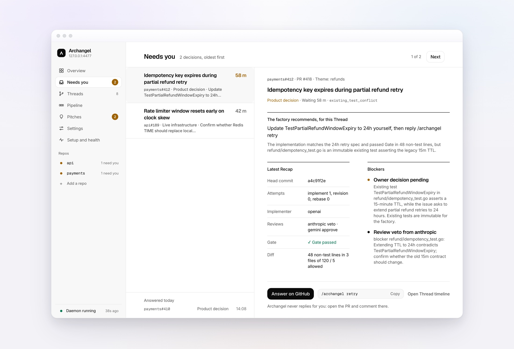

<h1 align="center">Archangel</h1>

<p align="center">
  <strong>Your own autonomous software factory. Ships bugs, features, and cleanups while you sleep.</strong>
</p>

<p align="center">
  Runs locally on the Claude, Codex, and Gemini subscriptions you already pay for.<br />
  Every pull request is verified by a mechanical Gate, reviewed by two rival AIs, and bounded by rules no agent can edit.
</p>

<p align="center">
  <a href="#get-started">Get started</a>
  &nbsp;·&nbsp;
  <a href="#how-it-works">How it works</a>
  &nbsp;·&nbsp;
  <a href="#capabilities">Capabilities</a>
  &nbsp;·&nbsp;
  <a href="#cli-reference">CLI reference</a>
  &nbsp;·&nbsp;
  <a href="#faq">FAQ</a>
</p>

<p align="center">
  <picture>
    <source media="(prefers-color-scheme: dark)" srcset="assets/readme/hero-dark.jpg">
    <source media="(prefers-color-scheme: light)" srcset="assets/readme/hero-light.jpg">
    
  </picture>
</p>

> **Shipping unattended today.** An agent audited a Go repository, found a real parser bug, wrote a failing-first test and fix, passed two independent AI reviewers, and merged into `main` without human intervention.

## Get started

**Requirements**

- Bun 1.4.5+, `git >= 2.38`, and GitHub CLI (`gh`)
- A least-privilege GitHub App created with `bun scripts/create-github-app.ts`
- Two or more logged-in AI CLIs (`codex`, `claude`, `agy`) for cross-vendor review

Install from source, onboard a repository, and open the local dashboard.

```bash
git clone https://github.com/dgrah50/archangel.git && cd archangel
bun install && bun run build && bun link
archangel onboard owner/my-repo
archangel doctor --smoke && archangel ui
```

Copy `.env.example` to `.env` and [archangel.example.yaml](./archangel.example.yaml) to `archangel.yaml`, merge the onboarding pull request on GitHub, then start the daemon.

```bash
archangel start              # run in the foreground
archangel daemon install     # or install as a macOS launchd background service
archangel daemon restart     # reload after editing archangel.yaml
```

The **Setup and health** page inside `archangel ui` tracks all 8 setup steps directly from your machine and GitHub, displays onboarding PR check status, and links to a prefilled smoke issue.

## Why Archangel?

- **Runs on subscriptions you already pay for.** Drives native `claude`, `codex`, and `agy` CLIs across multiple logins per provider with automatic failover and `$0` API bills.
- **Proves every change mechanically.** Bugfixes must add a brand-new test that fails on `main` and passes on the branch. Features need no new test file and must clear your full test suite. Existing tests stay immutable.
- **Enforces independent rival review.** If Codex writes the code, Claude and Gemini review it. Models can only approve or veto. No model can waive a failing Gate check.
- **Finds and pitches its own work.** Read-only Bug Scouts scan `main` on schedule. Weekly Pitch Scouts propose evidence-backed improvements and wait for you to promote individual slices.
- **Recovers before waking you.** Optional read-only machine triage retries a stuck Thread once (`escalations.factoryRetry: once`), records the triage steps in the PR Recap, and switches itself off per repo if retries stop paying off.
- **Keeps you in command from GitHub.** Leave normal inline PR review comments or reply `/archangel retry`, `/archangel close`, or `/archangel handoff`. Receive a quiet daily digest on Telegram.
- **Watches `main` after every merge.** If a landed fix turns CI red, Archangel trips the repo circuit breaker and opens an exact inverse revert PR automatically.

## How it works

Bugs can land end-to-end autonomously once you disable shadow mode. Features and promoted pitch slices are built, gated, and reviewed by the factory, then wait for your click to merge. Whenever a product call or conflict arises, Archangel parks that Thread in **Needs you** with a clear recommendation while everything else keeps moving.

<p align="center">
  <picture>
    <source media="(prefers-color-scheme: dark)" srcset="assets/readme/loop-dark.jpg">
    <source media="(prefers-color-scheme: light)" srcset="assets/readme/loop-light.jpg">
    
  </picture>
</p>

| Layer | Responsibility |
| --- | --- |
| **Host config (`archangel.yaml`)** | Owner GitHub ID, multi-account logins, provider chains, daily spend caps, autonomy caps, and per-repo shadow mode. |
| **Repo policy (`.agents/archangel.json`)** | Diff bounds, test commands, required checks, protected paths, review rubric, factory retry toggle, and Scouts read strictly from `main`. |
| **Thread** | One issue's validated state machine (`queued`, `working`, `awaiting_gate`, `reviewing`, `landing`, `shadow_ready`, `needs_you`, `done`) stored in SQLite. |
| **Mechanical Gate** | Ephemeral CI check that validates diff bounds, protected paths, test immutability, pre-commit hooks, and test proofs. |
| **Rival Review** | Two independent vendors that never share a provider with the implementer. |

## Capabilities

### 1. Live Thread inspection and mechanical Gate proof

Every issue becomes a Thread with a live phase rail, a newest-first Ledger audit timeline, full attempt provenance (provider, model, duration, transcript path), and a mechanical Gate proof checklist.

<p align="center">
  <picture>
    <source media="(prefers-color-scheme: dark)" srcset="assets/readme/threads-dark.jpg">
    <source media="(prefers-color-scheme: light)" srcset="assets/readme/threads-light.jpg">
    
  </picture>
</p>

- Filter active Threads by repository or jump directly to the GitHub issue and PR.
- Inspect every attempt, Broker push, Gate verdict, and rival review in one timeline.
- Merging any PR yourself resets that repository's autonomous step counter automatically.

### 2. Focused Needs You queue and bounded machine triage

When a Thread hits a conflict with an existing test, a reviewer veto, or a product decision, Archangel parks it off the main line so other Threads never stall. Each item arrives with a decision class, a recommendation, the latest Recap, and recorded blockers.

<p align="center">
  <picture>
    <source media="(prefers-color-scheme: dark)" srcset="assets/readme/needs-you-dark.jpg">
    <source media="(prefers-color-scheme: light)" srcset="assets/readme/needs-you-light.jpg">
    
  </picture>
</p>

- Enable `escalations.factoryRetry: once` in `.agents/archangel.json` to let read-only machine triage attempt one guided recovery before paging you.
- Every triage run logs vendor, decision, cause, and steps into the PR Recap and tracks outcome labels with automatic per-repo shutoff if retries fail or revert.
- Set `features.planApproval: owner` to make each `class:feature` Thread post a machine-written plan first and wait. Apply the `plan:approved` label (only your application counts) to approve exactly that plan, or comment to have it re-planned (at most 2 plans, then it asks you).
- Answer directly on GitHub with inline review comments or `/archangel retry`, `/archangel close`, or `/archangel handoff`. The dashboard stays read-only and never posts as you.

### 3. Repo-owned pipeline and PR-only policy editing

Every repository's rules live in `.agents/archangel.json` on `main`. The **Pipeline** page explains what each stage enforces, shows which layer owns each rule (built-in kernel, this machine, or repo policy), and lets you draft edits that open a normal pull request.

<p align="center">
  <picture>
    <source media="(prefers-color-scheme: dark)" srcset="assets/readme/pipeline-dark.jpg">
    <source media="(prefers-color-scheme: light)" srcset="assets/readme/pipeline-light.jpg">
    
  </picture>
</p>

- Edit Gate bounds, protected paths, review rubrics, landing modes, and Scouts with a bundled skills picker.
- Preview exact diffs before opening a PR. Any change that loosens a guardrail is flagged as `Looser` and labelled `policy:loosens`.
- Protected paths such as `.github/`, `.agents/`, lockfiles, and policy files stay off-limits to coding agents.

### 4. Subscription chains, multi-account failover, and host guardrails

Configure separate provider chains for `implement`, `revise`, `rebase`, `scout`, `triage`, and `reviewerChain` in **Settings** (form or raw YAML). Add multiple logins per CLI under `accounts:` in `archangel.yaml` without ever handing tokens to Archangel.

<p align="center">
  <picture>
    <source media="(prefers-color-scheme: dark)" srcset="assets/readme/settings-dark.jpg">
    <source media="(prefers-color-scheme: light)" srcset="assets/readme/settings-light.jpg">
    
  </picture>
</p>

- **Live vendor independence check.** Verifies as you edit that no reviewer shares a vendor with any writer chain.
- **Same-vendor-first failover.** Switches to a backup login of the same vendor before falling back across providers, bounded by a 4-switch cap, per-account daily limits, cooldown tracking, and full Ledger provenance.
- **Safe config writes.** Preview YAML diffs, require explicit confirmation when loosening host limits, write atomically with backups, and reload explicitly via `archangel daemon restart`.

### 5. Scouts, Pitches, and offline self-improvement

Read-only Bug Scouts inspect `main` using bundled or repo-specific skills (`general/`, `go/`, `typescript/`). Weekly Pitch Scouts propose scoped improvements backed by file citations and metrics.

- **Slice-level pitch promotion.** Review open pitches in the dashboard's **Pitches** view, tick the slices you want, and run `archangel pitch promote <repo> <issue> --slice 1,2 --chain` to create owner-authored `class:feature` issues.
- **Correction-loop drafting.** When you repeatedly correct the factory in the same category, Archangel drafts a prompt, skill, or rubric update and scores it offline against your captured `dev` and held-out eval sets before opening a draft PR.
- **Model-tier benchmarking.** Capture revise and rebase inputs with pinned base heads, then run `archangel eval bench-tiers` to test cheaper or faster model chains against the mechanical Gate before editing `archangel.yaml`.

### 6. Redesigned 7-page local dashboard

Start `archangel ui` (loopback `127.0.0.1:4477` by default) to monitor and configure the factory across seven focused pages.

| Page | What it shows |
| --- | --- |
| **Overview** | Waiting decisions and pitches, autonomy-cap warnings, live station line map, daily spend, cost per merged fix, and owner agreement rate. |
| **Needs you** | Oldest-first escalation queue with factory recommendation, latest Recap, blockers, and copyable `/archangel retry` commands. |
| **Threads** | Two-pane Thread browser grouped by urgency with phase rail, Ledger audit timeline, and mechanical Gate proof. |
| **Pipeline** | Per-repo stage rules (Intake, Build, Gate, Review, Landing, Scouts), skills picker, and PR-only draft panel. |
| **Pitches** | Read-only Scout pitch viewer with evidence, options considered, slice checkboxes, and copyable promote commands. |
| **Settings** | Machine settings (`Models`, `Accounts`, `Limits`, `Repos`, `Alerts`), Per-repo, Built-in kernel invariants, and Raw YAML tabs. |
| **Setup and health** | 8-step setup wizard with derived progress, onboarding PR checks, 24h daemon faults, and saved eval, replay, and tier-benchmark reports. |

### 7. Mechanically verified codebase invariants

Archangel enforces its own reliability rules in CI so critical state transitions and error boundaries do not drift silently.

- **Exhaustive formal model checker (`bun run verify:formal`).** Explores reachable states of the Thread, Command, Pitch, and Daemon Lock state machines via BFS to verify safety invariants and liveness bounds.
- **Structural AST lint (`bun run lint`).** Blocks silent catch handlers and recurring failure modes across the TypeScript source tree.

## Configuration examples

<details>
<summary><strong>Host config (<code>archangel.yaml</code>) and repo policy (<code>.agents/archangel.json</code>)</strong></summary>

Host config (`archangel.yaml`):

```yaml
ownerUserId: 123456 # gh api user --jq .id
authMode: subscription
accounts:
  - { id: codex-a, provider: codex, home: ~/.archangel/accounts/codex-a }
  - { id: codex-b, provider: codex, home: ~/.archangel/accounts/codex-b, maxAttemptsPerDay: 12 }
  - { id: claude-a, provider: claude, home: ~/.archangel/accounts/claude-a }
  - { id: agy-a, provider: agy, home: ~/.archangel/accounts/agy-a }
chains:
  implement: [{ provider: codex, model: gpt-5.4 }, { provider: agy }]
  revise: [{ provider: codex, model: gpt-5.4-mini }, { provider: agy }]
  rebase: [{ provider: codex, model: gpt-5.4-mini }, { provider: agy }]
  scout: [{ provider: claude }, { provider: codex }]
  triage: [{ provider: claude }]
reviewerChain: [{ provider: agy }, { provider: claude }, { provider: codex }]
projects:
  - repo: owner/my-repo
    defaultBranch: main
    shadowMode: true
    maxConcurrentThreads: 2
    maxAutoMergesPerDay: 3
    scouts: { enabled: false, maxRunsPerDay: 2, maxOpenProposals: 3, maxAutoPromotionsPerDay: 1 }
```

Repo policy (`.agents/archangel.json` on `main`):

```json
{
  "version": 1,
  "gate": {
    "maxNonTestLines": 120,
    "maxTotalLines": 260,
    "maxFiles": 5,
    "baseTestRuns": 3,
    "headTestRuns": 3,
    "testFileGlobs": ["**/*_test.go"],
    "testBuildCmd": "go test -run=^$ ./...",
    "baseTestCmd": "go test -count=1 ./...",
    "testCmd": "go test -race -count=1 ./...",
    "protectedPaths": ["go.mod", "go.sum", "Makefile"]
  },
  "requiredChecks": ["Gate", "Test"],
  "landing": { "bugfix": "autonomous" },
  "escalations": { "factoryRetry": "once" },
  "scouts": [
    { "name": "bug-hunt", "schedule": "daily", "maxProposals": 2, "skills": ["general/bug-hunt", "go/*"], "promotion": "owner" },
    { "name": "weekly-pitch", "kind": "pitch", "schedule": "weekly", "maxProposals": 1, "skills": ["general/bug-hunt"], "includeMetrics": true, "promotion": "owner" }
  ]
}
```

</details>

## CLI reference

<details>
<summary><strong>All CLI commands and flags</strong></summary>

| Command | What it does |
| --- | --- |
| `archangel start [--once] [-c <path>]` | Run the reconciler daemon continuously, or execute one tick and exit. |
| `archangel daemon <install\|restart\|uninstall\|status>` | Install, restart, uninstall, or inspect the macOS `launchd` background agent. |
| `archangel onboard <repo> [--dry-run]` | Create labels and open one onboarding PR with your `gh` CLI (never auto-merged). |
| `archangel doctor [--offline] [--smoke] [--json]` | Verify host config, GitHub App permissions, repo files, Gate pin drift, and CLI logins. |
| `archangel ui [--port <n>] [--host <host>] [--allow-remote]` | Serve the local 7-page dashboard (`http://127.0.0.1:4477`). Remote mode disables all write routes. |
| `archangel status [--repo <owner/name>] [--json]` | Print active Threads, `Needs you` queue, daily spend, merges, and shadow agreement. |
| `archangel metrics [--days <n>] [--repo <owner/name>] [--json]` | Print outcomes per merged fix, owner corrections, vendor agreement, and active cooldowns. |
| `archangel events [--repo <owner/name>] [--topic <prefix>] [--issue <n>] [--limit <n>]` | Inspect the append-only SQLite audit log. |
| `archangel scout run [name] [--repo <owner/name>] [--dry-run]` | Run read-only Scouts against `main`, or list declared Scouts with `--dry-run`. |
| `archangel scout skills` | List bundled Scout skills (`general/`, `go/`, `typescript/`). |
| `archangel pitch promote <repo> <issue> [--slice <n>] [--chain] [--yes]` | Turn pitch slice(s) (single number or comma list like `1,2`) into owner-authored `class:feature` issues. |
| `archangel workflow propose <repo> --file <path> [--prompts <dir>] [--base-sha <sha256>] [--dry-run]` | Validate a `.agents/archangel.json` draft and open one unmerged PR. |
| `archangel gate --base <ref> [--head <ref>] [--repo <dir>] [--skip-tests]` | Run the mechanical Gate locally against a repository ref. |
| `archangel gate-bump <--repo <owner/name>\|--all> [--dry-run]` | Open PRs to re-pin `ARCHANGEL_GATE_SHA` on repositories with Gate pin drift. |
| `archangel replay [--repo <owner/name>] [--since <days>] [--run-tests] [--json]` | Replay the mechanical Gate offline against captured PRs and seeded corruptions. |
| `archangel eval status [--repo <owner/name>]` | Show captured eval vault counts against calibration milestones. |
| `archangel eval run --candidate <patch> [--heldout] [--max-cases <n>] [--json]` | Score a candidate prompt, skill, or rubric patch offline against captured review cases. |
| `archangel eval bench-tiers --role <role> --candidate-chain <chain> [--run-tests] [--max-cases <n>] [--json]` | Benchmark a candidate `implement`, `revise`, or `rebase` chain against the current chain using the mechanical Gate. |
| `archangel retry <issue> [--repo <owner/name>] [-m <text>]` | Clear `needs_you`, re-snapshot the issue body, and resume a Thread with optional guidance. |
| `archangel abandon <issue> [--repo <owner/name>]` | Move a Thread to `done(abandoned)`. |
| `archangel disagree <issue> [--repo <owner/name>]` | Record owner disagreement (`factory:disagree`) on a shadow or autonomous merge. |
| `archangel handoff <issue> [--repo <owner/name>] [--repo-dir <dir>]` | Pause factory autonomy and hand off a Thread branch to Paseo. |
| `archangel resume <issue> [--repo <owner/name>]` | Resume advisory Gate and review tracking after a Paseo handoff. |
| `archangel reset-breaker [--repo <owner/name>]` | Clear a repository's red-main circuit breaker once `main` is green. |
| `archangel studio [--port <n>]` | Launch read-only Mastra Studio against `mastra.db`. |

</details>

## FAQ

### Do I need paid API keys to run Archangel?

No. Default `authMode: subscription` drives the native `claude`, `codex`, and `agy` CLIs that you log into yourself. If you have multiple accounts for a provider, list their separate home directories under `accounts:` in `archangel.yaml` and Archangel fails over cleanly on rate limits without reading or copying credentials. Metered `authMode: api` is also supported if you prefer API keys.

### How does the mechanical Gate differ from AI review?

The Gate is deterministic code running in an ephemeral GitHub Actions job pinned to `ARCHANGEL_GATE_SHA`. It reads `.agents/archangel.json` and `.pre-commit-config.yaml` strictly from `main`, verifies diff line and file caps, blocks edits to protected paths and existing tests, and runs test proofs. Bugfixes must add a new test that fails on `main` and passes on the fix branch. Features require no new test file and must pass your full test suite. Only after the mechanical Gate passes do two rival AIs review the diff, and reviewers can only veto.

### Will Archangel merge features or edit its own rules?

No. Features and promoted pitches always wait for your merge on GitHub. Policy files, CI workflows, and lockfiles are universally or explicitly protected, so agents cannot edit them. Even edits made in the local dashboard's Pipeline editor only open an unmerged pull request using your `gh` CLI.

### What happens when a repository starts in shadow mode?

New repositories default to `shadowMode: true`. Archangel runs the full loop (build, Gate, rival review) and records whether it would have merged, while leaving the actual merge to you. Once the Overview dashboard shows high owner agreement on shadow verdicts, you can turn off shadow mode for autonomous bugfix landing.

### Does Archangel run on Linux or only macOS?

The reconciler daemon (`archangel start`), CLI commands, Gate, and local dashboard (`archangel ui`) run on both macOS and Linux with Bun. Only the Gate bundle (`bin/archangel-gate.mjs`) runs on Node 22, inside the target repo's GitHub Actions. The `archangel daemon install|restart|uninstall|status` helper manages macOS `launchd` specifically.

---

**Pre-alpha.** Built for a single owner running locally. Local clone isolation is advisory, while GitHub App scopes and the pinned CI Gate are hard boundaries.

**License.** MIT. See [LICENSE](./LICENSE).
