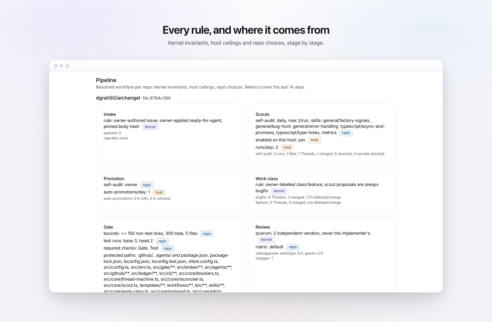

# Archangel

**Your own single-owner software factory for bugs, features, and chores.**

Archangel runs on your machine, watches your GitHub repositories, and turns issues, Scout pitches, and recurring engineering work into tested, cross-vendor-reviewed pull requests—on the AI CLI subscriptions you already pay for (`codex`, `claude`, and `agy`, with automatic failover). Every change passes deterministic verification and two independent model reviewers from different vendors before anything lands, bounded by a mechanical **Trust Kernel** that agents can never edit.

<picture>
  <source media="(prefers-color-scheme: dark)" srcset="assets/readme/hero-dark.jpg">
  <source media="(prefers-color-scheme: light)" srcset="assets/readme/hero-light.jpg">
  
</picture>

> On 2026-11-22, a bug Scout audited a Go repository, found a real parser bug, and filed it. Archangel implemented the fix, proved it through the mechanical Gate, passed two cross-vendor reviewers, and merged it into `main`—with nobody involved.

## Work classes

Archangel separates autonomous work from owner-merged work mechanically, encoded into the branch name (`factory/<n>` vs `factory/feature-<n>`):

| Work class | Status | Verification | Landing |
|---|---|---|---|
| **Bugfixes** | Live | Mechanical Gate: new test compiles & fails on `main` (`>= 3` runs), passes on fix (`>= 2` runs), strict diff bounds + 2-vendor review | Autonomous squash-merge (when both repo and host enable it) + post-merge `main` watch |
| **Features** (`class:feature`) | Live | Full test suite + build/typecheck + protected-path enforcement + 2-vendor review (owner-authored or pitch-promoted issues) | Always owner-merged |
| **Chores & Maintenance** | Pitches live; `class:chore` & package bumps on roadmap | Removals, cleanups, and repo hygiene via Pitch Scouts today; dedicated chore & scrubbed dependency-bump lane planned | Always owner-merged |

## How it works

<picture>
  <source media="(prefers-color-scheme: dark)" srcset="assets/readme/loop-dark.jpg">
  <source media="(prefers-color-scheme: light)" srcset="assets/readme/loop-light.jpg">
  
</picture>

### 1. Work generation: Scouts and composable skills
- **Bug Scouts (`kind: "bug"`):** Read-only scheduled audits against `main` (using `claude` or `codex` in read-only mode, secret-scanned and deduplicated) that file reproducible bug proposals. Proposals wait for your `ready-for-agent` label by default, or opt into capped auto-promotion (`scouts.maxAutoPromotionsPerDay`, default `1`) with automatic revocation on any disagreement, revert, red `main`, or 3 consecutive unmerged Threads.
- **Pitch Scouts (`kind: "pitch"`):** Weekly or manual read-only Scouts that file at most one evidence-backed proposal (`removal`, `performance`, `architecture`, `ux`, or `feature`) labelled `agent-pitch`. Every pitch is mechanically checked against cited files and metrics, vetted by an independent cross-vendor critic, expired after 14 days unanswered, and paused after 4 consecutive unpromoted pitches. Pitch Scouts never auto-promote: run `archangel pitch promote <repo> <issue>` to review each slice body in full and open owner-authored `class:feature` issues with your `gh` CLI.
- **Bundled skills (`skills/`):** Host-trusted, reusable detection lenses (`general/`, `go/`, `typescript/`—a protected path) that Scouts compose via `folder/name` or `folder/*` (`archangel scout skills`). Unknown skills fail closed.

### 2. Execution, mechanical Gate, review, and landing
1. **Role-tiered implementation on your subscriptions.** Archangel runs the configured provider chain for each Attempt role (`chains.implement`, `chains.revise`, `chains.rebase`, `chains.scout`; `codex`, `claude`, `agy`, each with an optional `model`) inside a throwaway clone with a scrubbed environment, so cheaper models can take menial roles. Quota or rate limits record a cooldown and fail over to the next CLI while carrying the working tree forward. Metered API keys (`authMode: api`) are supported too.
2. **A mechanical Gate proves every change.** Before review or merge, deterministic code checks diff bounds (at most 150 non-test lines, 300 total lines, 5 files, zero binaries), protected paths, pre-existing test and fixture immutability, and `.pre-commit-config.yaml` hooks from `main`. For bugfixes, it proves `main` is green, overlays the new test file onto `main` to verify it compiles and fails (`>= 3` runs, with optional JUnit test-ID diffing), then proves the full suite passes on the fix (`>= 2` runs).
3. **Two independent reviewers must approve.** Every passing PR is reviewed in parallel by two models from different vendors than the implementer—one verifying contract and test integrity, one actively trying to break the change—with backup vendor failover when configured.
4. **Clean landing and post-merge watch.** Features always wait for your merge. Bugfixes merge autonomously only when both the repo (`landing.bugfix: "autonomous"`) and your host (`shadowMode: false`) opt in (new projects default to `shadowMode: true`, posting a `WOULD MERGE` Recap first). After squash-merging the exact verified commit SHA, Archangel watches required checks on `main`: if `main` turns red, it trips the repo's circuit breaker and opens an exact-inverse revert PR (or escalates to `Needs You` if `main` moved on).

## Built around a Trust Kernel

Autonomy only holds up when the safety rails live outside the models. Archangel's **Trust Kernel** is enforced in code that agents cannot edit:

- **Protected paths agents can never modify.** `.github/`, `.agents/`, `.pre-commit-config.yaml`, `.pre-commit-config.yml`, `.gitattributes`, `.gitmodules`, `CLAUDE.md`, `AGENTS.md`, and `LICENSE*`/`COPYING*` are universally protected, plus each repo's `gate.protectedPaths` (lockfiles, build files, core modules). Enforced independently by the local Broker, the pinned CI Gate, and the Lander—backed by a least-privilege GitHub App (`contents:write`, `pull_requests:write`, `issues:write`, `checks:read`; never `workflows`, `administration`, or `checks:write`).
- **Strict version 1 workflow file, read only from `main`.** Each repo's `.agents/archangel.json` (`"version": 1`) is read strictly from the default branch, never from a PR. Kernel bounds (`150` non-test lines, `300` total lines, `5` files, `baseTestRuns >= 3`, `headTestRuns >= 2`) cannot be relaxed, and `requiredChecks` must include `Gate` plus at least one other CI check.
- **Fail-closed everywhere.** A missing or invalid `.agents/archangel.json` halts new work for that repo instead of falling back to defaults. Untrusted check apps (anything other than `github-actions`), edited issue bodies, tampered Scout proposals, and unparseable reviewer verdicts all halt progress.
- **Models only veto.** Deterministic Gate and blocker checks decide eligibility. LLM reviewers can block a PR, never waive a failing check.
- **Owner identity by numeric GitHub user ID.** Authorship, label actors (verified via GitHub's timeline API), reply commands, and PR review comments are verified against your numeric `ownerUserId`, never usernames.
- **Autonomy cap and host ceilings.** After `maxAutonomousStepsWithoutOwner` autonomous Attempt starts and merges (default `25`) without hearing from you, Archangel pauses new work until you reply or retry. Host ceilings in `archangel.yaml` (`maxAutoMergesPerDay`, `maxDailyUsd`, `maxConcurrentThreads`, Scout caps, `shadowMode`) cannot be raised by any repo.

Merge count is volume, not quality. `archangel metrics` and the dashboard track outcomes per merged fix: reverts, rework attempts, owner corrections, vendor agreement with you, and metered spend (`$0` on subscriptions).

<picture>
  <source media="(prefers-color-scheme: dark)" srcset="assets/readme/outcomes-dark.jpg">
  <source media="(prefers-color-scheme: light)" srcset="assets/readme/outcomes-light.jpg">
  
</picture>

## You stay in charge

Steer from GitHub (including mobile), your terminal, or the local dashboard—without babysitting agent chats.

- **Needs You with clear decisions.** Escalations map to six decision classes (`credentials`, `spending`, `live infrastructure`, `irreversible`, `product decision`, `owner signoff`), each with a concrete recommendation on the PR Recap, `archangel status`, optional Telegram alerts, and the dashboard.
- **One-line commands on GitHub.** Reply to any `Needs You` issue or PR with a first line of:
  - `/archangel retry` — passes any guidance below it, grants a fresh Attempt budget, and resumes.
  - `/archangel close` — abandons the Thread and closes its PR.
  - `/archangel handoff` — records the request and reminds you to run `archangel handoff <issue>` locally for a Paseo takeover (`archangel resume <issue>` resumes advisory tracking afterward).
  - Add `factory:paused` or `factory:stop` at any time to halt a Thread immediately.
- **Inline PR review feedback.** Leave inline diff comments or a review summary on a PR; on retry (by comment, CLI, or clearing `needs-you`), Archangel collects your comments and passes them to the next revision Attempt.
- **Daily digest.** Sent once per local day at or after `digestHour` (default `9`, via Telegram when configured) summarizing open `Needs You` items, merges, reverts, metered spend, and open Scout proposals and pitches—silent when nothing needs attention.
- **Local dashboard (`archangel ui`).** Reads directly from your local SQLite Ledger (`127.0.0.1:4477`), showing `Needs You`, active Threads, per-fix outcomes, Scout activity, and each repo's resolved pipeline with rule provenance (`kernel`, `host`, or `repo`). Its workflow editor previews semantic diffs, flags loosened limits, and **only ever opens an unmerged PR** with your `gh` CLI (labelled `policy:loosens` if any limit relaxes; disabled under `--allow-remote`; never writes `archangel.yaml`).

<picture>
  <source media="(prefers-color-scheme: dark)" srcset="assets/readme/pipeline-dark.jpg">
  <source media="(prefers-color-scheme: light)" srcset="assets/readme/pipeline-light.jpg">
  
</picture>

## Replay, evaluation, and safe self-improvement

Archangel measures its own reliability so policy, prompt, and Scout changes stay grounded in evidence rather than guesswork:

- **Immutable eval capture.** Pre-squash commit SHAs are pinned under `refs/archangel/eval/...`, and every Attempt and review records provider, model, prompt, rubric, and workflow hashes.
- **Offline replay & candidate scoring.** Run `archangel replay` to re-run the mechanical Gate against captured Threads and seeded corruptions of known-good fixes (`--run-tests` includes test-dependent mutants; exits `1` on regressions). Run `archangel eval status` and `archangel eval run` to score candidate prompt or rubric changes offline against captured, owner-verified cases.
- **Sanitized self-diagnostics.** Repeated owner corrections and failure clusters are tallied in closed enums (zero raw prose or logs) and can feed opt-in Scouts (`includeMetrics: true`, such as Archangel's own leaf-module `self-audit`).
- **Owner authority over rules.** Nothing edits its own prompts, skills, Scouts, or Trust Kernel automatically—every policy or capability change lands only through an owner-merged PR.

## Getting started

**Prerequisites:** Node.js 22+, `git >= 2.38`, authenticated GitHub CLI (`gh`), at least two logged-in subscription CLIs (`codex`, `claude`, `agy`)—or API keys for `authMode: api`—and a dedicated least-privilege GitHub App.

### 1. Install and configure credentials

```bash
git clone https://github.com/dgrah50/archangel.git
cd archangel
npm install && npm run build && npm link
```

Copy `.env.example` to `.env` (`chmod 600`)—or run `npx tsx scripts/create-github-app.ts` to create the least-privilege App via GitHub's manifest flow—and set `ARCHANGEL_GITHUB_APP_ID`, `ARCHANGEL_GITHUB_INSTALLATION_ID`, and `ARCHANGEL_GITHUB_PRIVATE_KEY_PATH` (plus `ARCHANGEL_GITHUB_BOT_USER_ID` if enabling Scouts, and optional Telegram vars).

### 2. Onboard a repository

```bash
archangel onboard owner/my-repo
```

Using your `gh` CLI, this creates the factory labels and opens one unmerged PR adding the pinned `.github/workflows/archangel-gate.yml`, a starter `.agents/archangel.json` (for Go and Node repos), and `.agents/scouts/bug-hunt.md`. Merge that PR, require `Gate` and your CI check in branch protection on `main`, and install your GitHub App on the repo.

### 3. Configure your host (`archangel.yaml`) and repo (`.agents/archangel.json`)

Copy [archangel.example.yaml](./archangel.example.yaml) to `archangel.yaml` with your numeric GitHub user ID (`gh api user --jq .id`):

```yaml
ownerUserId: 123456
dailyTimezone: America/New_York
digestHour: 9
maxDailyUsd: 20
maxAutonomousStepsWithoutOwner: 25
authMode: subscription
chains:
  implement: [{ provider: codex }, { provider: agy }]
  revise: [{ provider: codex }, { provider: agy }]
  rebase: [{ provider: codex }, { provider: agy }]
  scout: [{ provider: claude }, { provider: codex }]
reviewerChain: [{ provider: agy }, { provider: claude }, { provider: codex }]
projects:
  - repo: owner/my-repo
    defaultBranch: main
    shadowMode: true
    maxConcurrentThreads: 2
    maxAutoMergesPerDay: 3
    scouts: { enabled: false, maxRunsPerDay: 2, maxOpenProposals: 3, maxAutoPromotionsPerDay: 1 }
```

Each repo keeps its verification rules and Scouts in `.agents/archangel.json` on `main`:

```json
{
  "version": 1,
  "gate": {
    "testFileGlobs": ["**/*_test.go"],
    "testBuildCmd": "go test -run=^$ ./...",
    "baseTestCmd": "go test -count=1 ./...",
    "testCmd": "go test -race -count=1 ./...",
    "protectedPaths": ["go.mod", "go.sum", "Makefile"]
  },
  "requiredChecks": ["Gate", "Test"],
  "landing": { "bugfix": "autonomous" },
  "scouts": [
    { "name": "bug-hunt", "schedule": "daily", "maxProposals": 2, "skills": ["general/bug-hunt", "go/*"], "promotion": "owner" }
  ]
}
```

### 4. Verify, start, and open the dashboard

```bash
archangel doctor --smoke   # verify config, App permissions, repo files, and CLI logins
archangel daemon install   # install & load the macOS launchd agent (or run `archangel start`)
archangel ui               # open the local dashboard at http://127.0.0.1:4477
```

## Commands

| Command | What it does |
|---|---|
| `archangel start [--once] [-c <path>]` | Run the reconciler daemon continuously, or run one tick and exit. |
| `archangel daemon <install\|uninstall\|status>` | Manage the macOS `launchd` user agent (no secrets in the plist). |
| `archangel onboard <repo> [--dry-run]` | Create labels and open one unmerged onboarding PR with your `gh` CLI. |
| `archangel doctor [--offline] [--smoke] [--json]` | Audit config, App permissions, repo files, Gate pin drift, and CLI logins. |
| `archangel ui [--port <n>] [--host <host>] [--allow-remote]` | Serve the local dashboard (`127.0.0.1:4477`) and PR-only workflow editor. |
| `archangel status [--repo <owner/name>] [--json]` | Show Threads by stage, `Needs You`, daily spend, merges, and shadow agreement. |
| `archangel metrics [--days <n>] [--repo <owner/name>] [--json]` | Show funnel stats, per-fix outcomes, corrections, vendor agreement, and cooldowns. |
| `archangel events [--repo <owner/name>] [--topic <prefix>] [--issue <n>]` | Inspect the append-only SQLite Ledger audit log (`--limit <n>`). |
| `archangel gate --base <ref> [--head <ref>] [--repo <dir>]` | Run the mechanical Gate locally (`--revert-of`, `--skip-pre-commit`, `--skip-tests`). |
| `archangel replay [--repo <owner/name>] [--since <days>] [--run-tests] [--json]` | Replay the Gate offline over captured Threads and seeded corruptions; exit `1` on regressions. |
| `archangel eval status [--repo <owner/name>]` | Inspect captured eval cases available for offline reviewer/prompt scoring. |
| `archangel eval run [options]` | Score a candidate prompt or rubric change offline against captured cases (never lands anything). |
| `archangel gate-bump <--repo <owner/name>\|--all> [--dry-run]` | Open one unmerged PR per drifted repo to re-pin `ARCHANGEL_GATE_SHA`. |
| `archangel workflow propose <repo> --file <path> [--dry-run]` | Validate a `.agents/archangel.json` draft and open one unmerged PR. |
| `archangel scout run [name] [--repo <owner/name>] [--dry-run]` | Run declared read-only Scouts against `main` (or list them with `--dry-run`). |
| `archangel scout skills` | List bundled Scout skills (`general/`, `go/`, `typescript/`). |
| `archangel pitch promote <repo> <issue> [--slice <n>] [--chain] [--yes]` | Turn a Pitch Scout proposal into owner-authored `class:feature` issues via your `gh` CLI. |
| `archangel retry <issue> [-m <text>] [--repo <owner/name>]` | Clear `needs-you`, pass optional guidance, grant a fresh Attempt budget, and resume. |
| `archangel abandon <issue> [--repo <owner/name>]` | Move a Thread to `done` (abandoned). |
| `archangel disagree <issue> [--repo <owner/name>]` | Mark owner disagreement on a merge (`factory:disagree` on GitHub and Ledger). |
| `archangel handoff <issue> [--repo <owner/name>] [--repo-dir <dir>]` | Pause autonomy and hand off the Thread's branch to Paseo. |
| `archangel resume <issue> [--repo <owner/name>]` | Resume advisory Gate and review tracking after Paseo handoff (owner merges manually). |
| `archangel reset-breaker [--repo <owner/name>]` | Reset a repo's red-main circuit breaker after `main` is green. |
| `archangel studio [--port <n>]` | Launch read-only Mastra Studio on `127.0.0.1` (default `4111`) against `mastra.db`. |

## Status, known limitations, and roadmap

Archangel (`0.1.0`) is **pre-alpha**, built for a single owner running locally on their own machine:

- **Local execution model:** `archangel daemon install` targets macOS `launchd` (`archangel start` runs anywhere Node.js 22+ and `git >= 2.38` run). Attempts run in throwaway clones with scrubbed environments (advisory local isolation); the hard trust boundary is the least-privilege GitHub App, branch protection, and the pinned CI Gate.
- **Pre-alpha stability:** CLI flags, config fields, and the SQLite Ledger schema may change without compatibility shims. Keep `shadowMode: true` until you trust the verdicts, then opt in one repo at a time.

### Roadmap highlights
- **Fleet Scouts (`anti-slop` / code hygiene):** Cross-repo Scouts composing bundled hygiene skills (`implicit-state-machines`, `error-handling`, `repeated-work`, removals) across all watched repositories.
- **Self-improving work generation (Fleet Meta-Scout):** Read-only PR-mining across watched repositories (and later external reference repos + research feeds) to pitch new Skills, Fleet/Repo Scouts, Scout graduations, and workflow upgrades—each gated by read-only proof-of-life/backtest and owner merge.
- **`class:chore` & package bumps:** First-class chore lane for cleanups and scrubbed, owner-merged dependency updates while keeping lockfiles blocked on `factory/*`.
- **Level-triggered reactive signals:** Durable SQLite signal adapters with mechanical trust/taint levels so PR merges, advisories, releases, or error spikes can trigger the right Scout or work lane without dropping overnight events.
- **Off-laptop compute & richer evals:** Remote compute for read-only Scouts first, model-tier benchmarking, and regression watches per prompt/workflow hash.

## License

MIT — see [LICENSE](./LICENSE).
